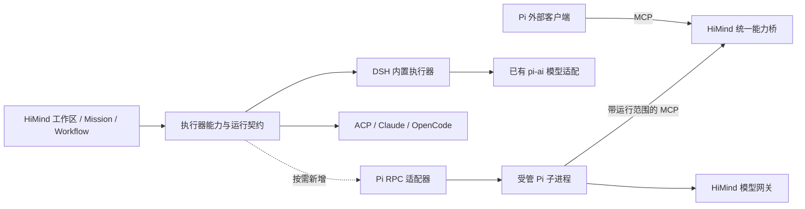

# HiMind Agent 接入 Pi 的必要性与实施评估

评估日期：2026-11-13。范围：当前工作树中的 HiMind Agent 0.3.92、随 Agent 分发的 DSH 0.2.2-rc.1.himind.1，以及 Pi 官方最新文档和稳定版 v1.5.2。本文是架构评估，没有安装 Pi、改动客户端配置或执行模型任务。

## 结论

**当前没有必要将 Pi 整体引入为 HiMind 的默认内核。值得优先提供 Pi 调用 HiMind MCP 的兼容方式；Pi 作为可选执行器，则应在小规模验证证明增量价值后再投入。Pi Durable 暂不适合作为生产任务内核替换。**

这并非从零接触 Pi：当前 DSH 的模型适配已经依赖 `@earendil-works/pi-ai`。应分别讨论模型库、外部客户端、执行器、持久任务内核四个层级，避免重复建设。

对当前“工作区管理、项目历史、继续会话”的产品目标，只有实际使用 Pi 的用户才会受益于新增 Pi 历史来源。单纯为了接入 Pi 而新增第六种来源，优先级低于已有来源的稳定性和恢复体验。

## 1. 已核实的版本和能力

GitHub 最新稳定发布为 **v1.5.2，2026-11-10 发布**，提交 `b4afdddf44e059c67ccf5097e5317d913521b470`。另外核对了 2026-11-13 的 main 提交 `d36266e06669c6991a7c9509d1da04d18d30378d`。二者部分文档不同，不能把 main 新增内容默认视为稳定版能力；以下核心判断以稳定版可核实的能力为依据。

| 层级 | Pi 的实际能力 | 对 HiMind 的意义 |
| --- | --- | --- |
| `pi-ai` | 多提供商模型 API、流式输出、模型与用量类型 | 当前 DSH 已间接使用，新增 CLI 不等于新增模型底座 |
| `pi-agent-core` / coding-agent | 模型与工具循环、上下文压缩、事件、可继续和分支的会话 | 与现有 DSH 和外部执行器重叠，优势在可编程扩展与宿主控制 |
| CLI / RPC / SDK | 终端、单次运行、JSON 事件流、JSONL RPC、TypeScript SDK | Rust 宿主适合 RPC 子进程；SDK 适合独立 Node/Bun 服务 |
| MCP / codemode | 原生 MCP 客户端、工具搜索、延后暴露工具、脚本组合调用 | 可消费 HiMind 已有能力，值得评估多工具场景的上下文开销 |
| 扩展与包 | TypeScript 扩展、工具事件钩子、skills、prompts、packages | 有生态复用价值，但扩展直接在 Pi 进程中执行 |
| `pi-durable` | 持久会话、工具调用与任务状态、检查点、崩溃后恢复 | 有研究价值；官方仍明确标为 Experimental，API 可无通知改变 |
| 权限隔离 | 官方明确没有内置文件、进程、网络或凭据访问限制系统 | 不能直接兑现 HiMind 的工作区访问和工具策略契约 |

Pi 有原生 MCP，不能沿用旧版“必须通过第三方扩展才支持 MCP”的判断。本次核对的官方接入文档列出 SDK、JSON 和 RPC，未发现官方 ACP 接口；这不代表第三方没有桥接实现。

## 2. HiMind 当前已经拥有什么

### 模型层已经部分复用 Pi

当前分发链的证据相互一致：

- [DSH 依赖锁](../../scripts/runtime/locks/deepseek-harness-0.2.2-rc.1.pnpm-lock.yaml) 中，`@deepseek-ai/dsh-llm-pi-ai@0.2.2-rc.1` 依赖已解析到 `@earendil-works/pi-ai@1.5.0`。
- 本地构建源 `manual-releases/deepseek-harness-runtime-source/0.2.2-rc.1.himind.1/node_modules/@deepseek-ai/dsh-llm-pi-ai/` 的包描述为 pi-ai-backed adapter，编译代码实际导入 pi-ai 的 providers、OpenAI 和 Anthropic API。
- [deepseek_harness.rs](../src/runtime/deepseek_harness.rs) 生成和读取 `llm-pi-ai.providers`，并处理模型、服务和凭据来源。
- [Runtime 发布清单](../resources/runtime/himind-runtime-release.json) 将这一 DSH 修订锁定为当前 Agent 的分发版本。

这证明当前代码和分发依赖链在模型层使用了 Pi，不代表本次已经启动安装版并测过每一种模型或 Pi CLI 功能。也不意味着需要单独把 pi-ai 升到 1.5.2；升级仍应随 DSH 锁版本和协议回归进行。

### 调度和治理并非空白

| 当前结构 | 已有职责 | Pi 接入时的边界 |
| --- | --- | --- |
| [runtime/mod.rs](../src/runtime/mod.rs) | Native、DSH、Codex、Copilot、ACP 分发；受管运行身份、claim、记录和结果 | Pi 应接入统一执行边界，不能旁路运行记录 |
| [workflow/runtime.rs](../src/workflow/runtime.rs) | 执行器、模型、取消、工具策略与用量映射 | 新 provider 需要同时进入预检、执行和能力声明 |
| [Mission 契约](../src/mission/contract.rs)与[调度](../src/app/mission_dispatch.rs) | 计划确认、访问范围、预算、独立验收与恢复关联 | Pi 的 agent loop 不能替代这些业务职责 |
| [ACP 执行器](claude-opencode-executors.md) | Claude/OpenCode 的实际模型目录、工具执行、权限请求和协议用量 | 仅增加另一种 coding CLI 的边际收益有限 |
| [统一 MCP 桥](adr/0001-mcp-single-bridge-for-downstream-tools.md) | 工具接入、下游凭据、审批、审计和能力注册 | Pi 应消费同一入口，避免重新展开所有下游服务 |
| [本机模型网关](../src/app/inference_gateway.rs) | 多绑定、协议路由、本机令牌、上游凭据保留与用量台账 | 可作为 Pi 的受管模型入口，实际协议仍需联调 |
| [工作区会话历史](workspace-session-history.md) | DSH、ACP、Claude、Codex、OpenCode 五来源，项目归属、分页和部分恢复 | Pi 历史需要独立来源适配，不会随执行器接入自动完成 |

[builtin.rs](../src/runtime/builtin.rs) 已有 `AIRuntimeAdapter`，但活动实现固定为 DSH，启动描述包含 `agent_patch`，事件投影也仍包装 DSH。它是值得继续完善的边界，并不是换一个实现即可无损替换的成熟多内核接口。

## 3. 哪些能力值得吸收

**优先：让 Pi 用户直接使用 HiMind MCP。** Pi 作为 MCP 客户端连接现有 HiMind stdio 入口，使用工作区、知识、任务和业务能力。这主要是客户端兼容、连接配置和使用指引，不要求 HiMind 安装、分发或调度 Pi。HiMind 对其 MCP 能力继续治理；Pi 自己的本地 Shell、文件工具并不因此进入 HiMind 的治理范围。

**有条件投入：可编程工具组合和扩展。** Pi 的 `tool_search`、MCP deferred exposure 和 codemode 适合大量工具的发现与组合；扩展钩子也方便做定制工具和事件适配。这是比“又能聊天、写代码”更有价值的差异。应实测与当前 HiMind 工具桥的重复程度、工具发现准确率、输入 token 和延迟，不能先断言一定省钱或更强。codemode 的脚本沙箱也不等于其调用的 Shell、MCP 服务或整个 Pi 进程被隔离。

**有用户需求再做：项目会话与分支。** Pi 将会话保存为带 `id/parentId` 的 JSONL 树，头部有 `cwd`，可以继续或分支。可沉淀到工作区的功能包括 Pi 来源识别、项目归属、活动分支阅读、提问导航、用量展示和恢复命令。树结构不能按文件追加顺序直接当成一条线性对话；要避免把互斥分支混在一起。

**研究储备：Durable 的提交后展示和恢复设计。** 先持久提交再投影界面、明确区分等待和取消、对工具重放声明安全性，值得作为 HiMind 长任务恢复的设计参照。HiMind 已有任务恢复和运行记录，真正要验证的增量是一次执行内部的模型/工具检查点，而不是另建一套 Mission。

## 4. 推荐接入结构

两个接入方向可以分别交付：外部 Pi 调用 HiMind MCP，并不意味着 HiMind 已能指派 Pi 执行任务。

若验证后决定新增执行器，建议增加独立 Pi provider，使用 `pi --mode rpc`，保留 DSH 默认位置。RPC 与 Rust 进程边界匹配，也能通过 stdin 传长输入。不要在 React/WebView 中运行 SDK 或保存模型凭据；只有 CLI RPC 无法满足控制要求时，再评估 SDK sidecar。Pi RPC 和 ACP 都走 stdio 并不意味着协议相同，增加 ACP profile 不能代替适配。

| 方案 | 判断 | 理由 |
| --- | --- | --- |
| Pi 调用现有 HiMind MCP | 建议优先兼容 | 成本小，复用现有治理与能力 |
| 新增 Pi RPC 可选执行器 | 经验证后决定 | 适合 Rust 宿主，便于与现有执行器做对照 |
| 引入第三方 Pi→ACP 桥 | 暂不优先 | 多一层版本、权限、用量和事件语义映射；有成熟实现时可重新比较 |
| 用 TypeScript SDK 自建 sidecar | RPC 不够用时考虑 | 控制更深入，但增加一套宿主服务和资源生命周期 |
| 替换 DSH 默认内核 | 当前不建议 | 要迁移专家、工具、权限、事件、会话、Office 集成与分发保障 |
| 用 Durable 替换 Mission/Workflow | 当前不建议 | 层级重叠、双重状态事实源，且 Durable API 仍实验性 |

## 5. 真正影响成熟度的工程工作

### 权限不能只靠启动目录或提示词

Pi 官方明确指出，`cwd` 只影响默认路径和资源发现，不限制访问其它路径；`--approve` 是项目信任，不能映射成 HiMind 的工具授权或 `full_access`。

Pi 扩展可通过 `tool_call` 阻止调用，原生 MCP 调用也经过工具管道，因此**可以实现 HiMind 审批桥**；但 Pi 没有现成的 HiMind 审批协议，且进程内扩展仍具有该进程的系统权限。要分开兑现“调用前审批”和“操作系统访问范围”。未实现和验证某种权限模式时，预检应明确拒绝，不要宣称支持 `files_only`、工作区隔离或禁网。

受管运行应使用独立 `PI_CODING_AGENT_DIR` 和会话目录，显式控制模型、扩展、MCP、skills 与上下文加载，避免混入个人配置。注意：仅用 `--tools read,...` 不会自动移除全部 MCP 工具；`--no-tools`、排除工具和扩展资源加载还需按实际版本一起验证。项目配置的 `sessionDir` 也可能在项目信任判定之前读取，不能把拒绝项目信任当成完整启动隔离。

### 生命周期、完成和取消都需要映射

- `prompt` 响应成功代表输入被接受、排队或被扩展处理，不代表任务完成。
- `agent_end` 后仍可能重试、压缩或继续排队输入；会话完成应观察 `agent_settled`，再结合错误、最终结果和宿主验收判断业务成功。
- 用户停止应考虑先 `clear_queue` 再 `abort`；Pi 文档说明只 abort 时，剩余排队输入可能继续。还要处理超时、挂起工具、异常退出和 Windows 子进程回收。
- stdout 按严格 UTF-8/LF JSONL 读取，处理请求 ID、背压、半行和日志分流。子进程隔离是故障边界，本身不是权限沙箱。

### 模型和费用保持统一口径

受管 Pi 优先连接 HiMind 模型网关，先验证实际启用的 OpenAI Chat / Responses / Anthropic 协议以及工具、多媒体、压缩和流式错误行为。外部个人 Pi 则可继续拥有自己的服务和登录，不能混淆两类来源。

用量必须来自协议或网关，包含重试、压缩和分支摘要等额外调用；事件累计值和会话总值不能重复计费。Pi 模型目录的 cost 不天然等于 HiMind 渠道实际价格或账单，未知费用不能当作零。[Mission 当前逻辑](../src/app/mission_dispatch.rs) 在声明 token/费用上限而缺少可信用量时会拒绝继续，这一约束应保留。

### 工具和历史都有独立边界

工具仍经 HiMind 单一 MCP 桥，并携带 run/work item、用户、项目和允许能力范围；避免在受管执行中再次调用同一个 Mission 的启动或调度入口形成递归。Pi 的 extensions/packages 与 HiMind 插件包并不兼容，需要显式适配和版本管理。

历史适配应读取真实会话头部 `cwd`，复用工作区规范化和最长目录匹配，不依赖编码后的目录名反推路径。自行只读解析，避免通过会自动迁移旧格式的可写 SessionManager 打开私人历史。需覆盖活动分支、跨文件 fork、压缩记录、截断尾行、超大文件、自定义目录和正在写入的记录。恢复要绑定精确会话和目录，不能默认“继续最近一次”。

Windows 分发还需覆盖 Node 或独立二进制、Git Bash/PowerShell、中文路径、无终端 RPC 启动、子进程取消和离线安装。成熟分发沿用 [ADR 0018](adr/0018-agent-bundled-pinned-runtime.md) 的精确版本、哈希/签名、安装和回滚原则，不能依赖运行时下载 latest。Pi CLI 的 npm 运行环境要求 Node >=22.19；是否复用现有 Runtime 携带的 Node，需要验证，而非默认共享依赖目录。

### Durable 的恢复不是外部操作恰好执行一次

Durable 官方文档规定：中断的工具只有声明 `replay: "safe"` 才会重跑，否则返回 interrupted；外部副作用仍需工具自己提供幂等性。持久检查点不保证发消息、创建工单、部署或提交等外部动作恰好发生一次。

另外，存储要求一个写入进程，不能把本地持久存储直接当成多 Agent 分布式任务队列；它也不会自动恢复已失去状态的任意外部 CLI。使用 Durable 要新建专门的集成，当前 coding-agent 包没有依赖 pi-durable，不能把 CLI/RPC 会话持久化等同于 Durable 的执行恢复。

## 6. 工作量和推进条件

以下是源码调查后的初步工程估算，以一名熟悉 HiMind Rust/Tauri 和 Node 的工程师、Windows x64 为前提，包含相应验证，不包含模型调用费用、等待第三方修复和全平台认证。人日不能直接视为日历天；验证后应重新收敛估算。

| 可独立选择的交付范围 | 初步工作量 | 交付边界 |
| --- | --- | --- |
| Pi 作为 HiMind MCP 客户端 | 1–3 人日 | 连接示例、作用域/审批行为、版本兼容和合成联调；不调度 Pi |
| 工作区新增 Pi 历史来源 | 4–7 人日 | 项目归属、分页预览、搜索、活动分支、精确恢复入口；不含完整会话树编辑器 |
| Pi RPC 技术验证 | 3–5 人日 | 隔离测试项目、模型网关、事件、MCP、停止和用量；不作为生产能力发布 |
| Pi 成熟可选执行器 | 25–40 人日，包含上面的 RPC 验证 | provider/模型发现、Workflow/Mission、权限能力门禁、事件、预算、打包回滚、Windows 回归；不含独立历史功能和 DSH 内核迁移 |
| 新增与 DSH 等价的 Windows 工作区隔离 | 若现有宿主隔离不能直接复用，额外约 10–20 人日 | 需在验证阶段确认可行性；没有通过隔离验收时不开放相应权限模式 |
| DSH 默认内核完整替换 | 60–100+ 人日，作为另一条替代方案估算 | 含工具、专家、UI、会话、Office、模型、治理与分发迁移；不能把可选执行器简单加总当作完整替换 |
| Durable 研究验证 | 单独 5–10 人日 | 只验证检查点、幂等和单写入者恢复；现阶段不承诺生产替换工期 |

不建议同时启动以上所有工作。建议顺序：先验证外部 Pi→HiMind MCP；如已有 Pi 用户，再补工作区历史；只有扩展生态或执行效果出现明确需求时，才做 RPC 验证。Durable 保留为独立研究。

### RPC 验证的决策标准

使用相同模型、同一提交和等价工具，挑选至少 10 个有宿主固定验收的代表任务，每个执行器重复 3 次。覆盖代码修复、文档、文件任务、多 MCP 工具组合和长上下文；Windows 生命周期另外用确定性的测试验证。记录成功率、人工介入次数、墙钟时间、真实用量、错误和取消后的残留进程。

以下为建议决策阈值，不是已有实测结果：

- 至少存在一项明确增量：已有业务必需的 Pi 扩展，或者在代表任务中成功率提高约 10 个百分点，或者同等成功率下用量/延迟改善约 20%。样本只用于筛选，正式默认切换需扩大验证。
- 取消后无继续调用、拒绝操作无副作用、越界和未知权限模式被拒绝，必测用例全部通过。
- 用量可对齐，重试与压缩没有漏记或重复记账；未知费用不绕过预算门禁。
- 强制退出后运行状态可解释、不会盲目重复外部写操作，安装升级能回滚。
- 如果只是增加一个效果相近的 coding CLI，而维护成本、审批和恢复风险明显增加，则停止产品化，保留外部 MCP 兼容即可。

## 7. 核对来源和验证限制

官方来源：

- [Pi 最新文档入口](https://pi.dev/docs/latest)；[v1.5.2 稳定发布](https://github.com/earendil-works/pi/releases/tag/v1.5.2)。
- [稳定版 README：包层级、权限边界、安装方式](https://github.com/earendil-works/pi/blob/b4afdddf44e059c67ccf5097e5317d913521b470/README.md)。
- [RPC 协议](https://github.com/earendil-works/pi/blob/b4afdddf44e059c67ccf5097e5317d913521b470/packages/coding-agent/docs/rpc.md)、[RPC 命令与取消](https://github.com/earendil-works/pi/blob/b4afdddf44e059c67ccf5097e5317d913521b470/packages/coding-agent/docs/rpc-commands.md)、[SDK](https://github.com/earendil-works/pi/blob/b4afdddf44e059c67ccf5097e5317d913521b470/packages/coding-agent/docs/sdk.md)。
- [原生 MCP 与工具暴露](https://github.com/earendil-works/pi/blob/b4afdddf44e059c67ccf5097e5317d913521b470/packages/coding-agent/docs/mcp.md)、[安全与项目信任](https://github.com/earendil-works/pi/blob/b4afdddf44e059c67ccf5097e5317d913521b470/packages/coding-agent/docs/security.md)。
- [会话格式](https://github.com/earendil-works/pi/blob/b4afdddf44e059c67ccf5097e5317d913521b470/packages/coding-agent/docs/session-format.md)、[Pi Durable 的实验状态与恢复边界](https://github.com/earendil-works/pi/blob/b4afdddf44e059c67ccf5097e5317d913521b470/packages/durable/README.md)。

本次证据快照在 `target/pi-analysis-20261113/`，稳定版位于 `stable-v1.5.2/`，版本与发布元数据另有 JSON 记录。源码分析基于当前包含未提交修改的工作树，因此它反映当前实现，不代表这些功能已经全部发布。

本次未安装或运行 Pi，未访问私人会话正文和凭据，未进行模型效果、MCP 真实互操作或性能测试。必要性判断有文档和源码依据；兼容性、效果与工期仍需按上述验证收敛。
