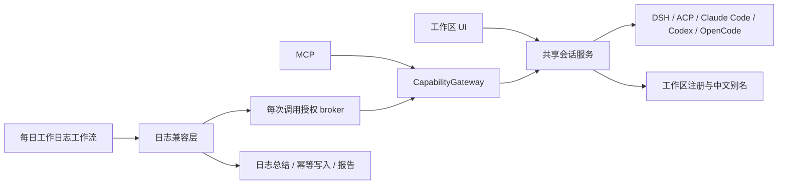

# 会话与活动公共服务

此实现将工作区 UI 已有的五来源历史聚合移至 `src/session_service.rs`，供 Tauri 命令与 CapabilityGateway 共用。公共能力合同版本 `1.0.0`，响应 `session_history.v1`。这是隔离分支的候选实现；能力发现结果才是可用性依据，不能仅凭已安装 Agent 的版本号推断本功能已上线。



## 能力与范围

| 能力 | 行为 |
| --- | --- |
| `workspace.session.sources` | 元数据来源状态和会话数，不加载正文 |
| `workspace.session.list` | 范围内会话分页；标题、目录和项目别名关键词过滤 |
| `workspace.session.messages` | 一个会话的只读正文页；尊重 `limit`，不超过来源原生页 50 条 |
| `workspace.session.activity` | `[from,to)` 消息活动与证据，按消息自身时间归窗 |

输入 Schema 以能力目录 `describe` 返回值为准，集中生成于 `session_service/query.rs`。四能力都是本机 read_only，使用现有鉴权、审批策略与 MCP 动态激活机制。插件须声明 `capability_dependencies`，消费每次调用注入的 broker；不另建公共 HTTP 服务。

- `scope=all` 为默认；有 `project_id` 而未给 scope 时默认为 project。
- `scope=project` 需要稳定的注册项目 ID；`include_children=true` 包含后代，会话仍保留实际子项目 ID 与中文别名。
- `scope=unassigned` 返回无法归属已登记项目的会话。不是临时虚构一个项目。
- `sources` 可选五来源的子集；`query` 最多 200 字符，仅筛选元数据。没有静默读取全部正文搜索。
- 会话身份 `source:native_id`；出现同 ID 不同目录的歧义时返回 `SESSION_ID_AMBIGUOUS`，不猜测读取哪一份。
- 正文按需重新校验来源和项目归属；UI 原有严格项目读取保留。全局读取和项目范围共用同一适配器。

```json
{"scope":"project","project_id":"stable-project-id","include_children":true,"sources":["codex","claude_code"],"from":"2026-11-16T00:00:00+08:00","to":"2026-11-18T00:00:00+08:00","limit":200,"max_chars":4000}
```

## 事实与完整性

活动时间必须是带显式偏移的 RFC3339，区间不超过 31×24 小时。源文件 mtime 只能作为列表更新时间，不能作为每日工作时间。缺少消息时间会计入 `undated_messages` 并使本页 `complete=false`；不会把整段会话挪到最近一天。ACP 新轮次记录用户接收和助手完成的 UTC 秒；旧 `acp_session.v1` 无此可选字段时继续可读、时间保持未知。

每条活动返回原生会话/消息 ID、显示所属项目、角色、截断标识，以及 `session_id/message_id/snapshot_revision/content_sha256` 证据。hash 对原消息正文计算；它是定位与完整性线索，不是客户端签名或永久归档。客户端记录删除后不能凭引用重建。文件操作请求标记 `file_request`，不当作已执行成功的文件差异；推理内容沿用既有适配器过滤。usage 尚未统一投影，明确返回 `usage_status=not_projected`，不填零用量或零费用。

`complete` 描述本页读取质量，必须连同 `next_cursor`、所有来源状态和所有页的 skipped/undated 汇总判断。存在下一页时不能宣称整个窗口采集完成。不存在的客户端会报告 unavailable/source_not_found；运行中 DSH 宿主缺席则 runtime_not_running。调用者可按来源决定回退或展示不完整，不能将失败解释为没有工作。

## 预算、恢复与取消

- `limit` 1–200；每条正文最多 8,000 字符；文件请求最多 4 项，路径 1,024 字符；messages 文件片段每字段 512 字符，activity 不投影文件正文。
- activity 每次最多读取 8 个来源正文页，并在页边界检查 20 秒软预算；来源自身还有文件/数据库大小和扫描数量上限。单次同步读取不能中途抢占，边界前的一次来源操作可能让软预算超时。
- DSH 读操作使用既有短时 Runtime 探测传输；宿主列表和消息查询另外有跨宿主软预算。每个响应最多 12 MiB，超出返回明确错误。
- 游标是不含正文的 base64 状态，绑定操作、请求参数、注册表 revision 与会话摘要。服务重启后可以继续；请求或源快照变化返回 `SESSION_SNAPSHOT_CHANGED`，调用者应重启该窗口并按稳定 ID 去重，不能继续旧游标跳过数据。
- 原生页被截成更小响应时，还绑定原生页 hash，防止页内修改静默错位。游标不是授权凭证；范围和来源每次重校验。
- 停止请求下一页即可取消后续读取。日志消费端有 context 截止时间与调用预算。尚无后台采集 Job、持久活动索引或硬实时取消。

## DSH 跨进程

桌面宿主只发布当前用户保护的代理引用到本 profile 的 `runtime/session-history-hosts/<pid>.json`，原子替换。正文不落入该文件。无 UI 的 MCP/插件宿主验证 PID、进程创建时间、profile，再解密并通过现有带会话认证的 loopback 代理调用 Runtime。拒绝外网、额外 query、userinfo 等 URL；僵尸记录不复活进程，也不访问 DSH 私有存储。关闭宿主后 DSH 来源不可用是预期边界。

## 工作日志消费与 t3code 后续

工作日志采集器 0.8.0 是兼容门面：优先用公共 activity 服务，未迁来源保持原采集器。日志拥有总结、分类、人工工时与锁定；Agent 只提供事实。`workspace_project_id` 与日志业务 `project_id` 分开，展示优先中文别名。迁移仍使用旧 source/native session/date 去重键。

这为未来按工作区查历史、引用会话和继续客户端提供底座。实时事件订阅、执行会话状态、Git 变更审查、worktree 生命周期、审批与取消仍须复用现有 LocalRun/Mission/Runtime 所有权，不能把历史记录的 mtime 当运行状态，也不能据此再建一套调度器。大规模增量活动索引是下一阶段；当前有限预算读历史可能在海量会话下返回需要缩窗/兼容回退。

## 验证与交付边界

合成回归覆盖作用域、半开日期区间、游标重启与失效、页预算、来源故障、未归属读取、加密 ACP 兼容、DSH 跨进程活进程认证、MCP 动态激活。跨仓 fixture 编译 Go collector/work-log，通过真实 CapabilityBrokerSession → CapabilityGateway → Codex 合成来源 → 日志进程验证合同和幂等落盘；启用环境 `HIMIND_HISTORY_EXTENSIONS_FIXTURE`、`HIMIND_HISTORY_COLLECTOR_FIXTURE`、`HIMIND_HISTORY_WORKLOG_FIXTURE` 后运行 Rust `session_` 测试。

未自动提交、发布、安装或重启生产。现有发布目录和不可变 artifact hash 不改写；未来发布流程须先构建新版插件，再按实际制品生成工作流依赖锁和市场索引。无需人工 UI 验收的原因是本次没有新增工作区交互页；原生生产运行与实际私人客户端覆盖不以合成测试冒充。

本次实施的验收、证据和回滚基线见 [2026-11-17 交付记录](session-activity-delivery-20261117.md)。
