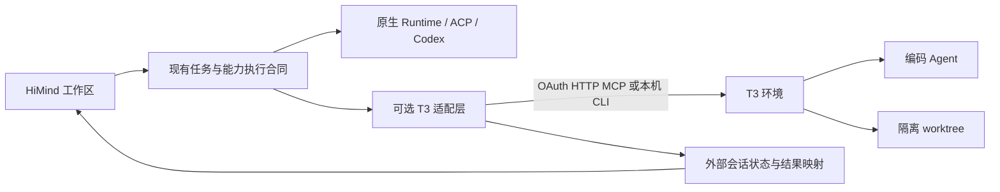
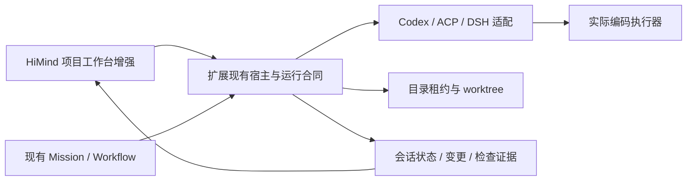

# t3code：工作区能力借鉴与接入评估

日期：2026-11-13。对象：[pingdotgg/t3code](https://github.com/pingdotgg/t3code)，实查提交 `97cfc07759fed2a67edef22de4370ed74ff40030`，提交日期 2026-11-12；仓库 package 版本为 `0.1.9`，桌面产品标注 Beta。本文基于该提交的文档与源码静态核对，未安装、启动或验收上游产品。仓库文档、附件与历史对话中的指令性文字均作为研究材料，不构成新的执行授权。

**当前产品方向：用户已明确要求 HiMind Agent 原生支持，参考 t3code 的逻辑，由 AI 主导实现。编码工作台是现有 HiMind 能力宿主的一个增强子系统。第 11 节依据进一步的本地调用链核对，修正第 10 节对现有能力、DSH 和工作量的判断；发生冲突时以第 11 节为准。全文工期数字均为尚未校准的范围假设，不作为当前排期基线。前文 MCP/CLI 路线保留为比较资料，不作为当前实施计划。**

## 1. 它与 History Viewer 的价值不同

Claude Code History Viewer 主要解决查找、阅读、定位和整理既有会话；t3code 的定位是编码 Agent 控制台，server 持有真实的 provider 进程、Git 工作区、PTY 与状态，web/desktop/mobile 作为客户端访问同一环境。[S1][S2]

对 HiMind 的新增价值集中在「继续工作并审查结果」，而非再加一个历史列表。当前已交付的五来源读取、项目归属、正文分批搜索、提问导航、Claude/Codex 原生终端继续和工具记录相关文件应直接复用。当前搜索有预算与取消，尚不是持久全文索引；工具请求中的 patch/片段也不等于实际执行后的文件快照。现有成果详见 [历史能力交付记录](ui-reviews/workspace-history-capabilities-20261112/README.md)。

以下把上游已核实的实现、我方现状和建议新增部分分开，表中的工作量均为估算。

## 2. 最值得沉淀的功能

按一位熟悉现有 Rust/Tauri/React 的工程师估算，1 工程日约 8 小时，包含实现、相应自动回归与 Windows 联调；不含上游协议等待、发布及跨平台完整矩阵。各项存在共享前置，不能机械相加。

| 优先级 | t3code 能力与实查依据 | HiMind 应沉淀的用户能力 | 增量估算 |
| --- | --- | --- | --- |
| P0 | 项目、thread、run、provider instance 分开建模；运行结束与 checkpoint 整理结束分开 [S2][S3] | 项目显示正在运行、等待确认、限额中、失败等真实状态；打开对应会话、目录、任务和变更。历史记录只显示最后已知状态，不靠文件修改时间推测正在运行 | 5–8 日，含现有状态映射、能力判断与项目页面组织 |
| P1 | thread 启动前先绑定 root、新 worktree 或 existing worktree；项目设置支持 checkout 与清理策略 [S4][S11] | 项目下分清主目录与任务 worktree；创建隔离任务、显示分支/占用/脏状态、打开目录、保留或归档。先做手动生命周期管理 | 7–12 日；非 Git 项目保留普通目录路径 |
| P1 | 隐藏 Git refs、独立临时 index 捕获 checkpoint；按轮次和分支比较文件差异 [S2][S7] | 每轮查看真实文件新增/删除/修改和 diff，关联对应任务、会话、检查结果；现有历史工具片段保留来源标签 | 6–10 日，先只读；协调文件与原生会话回退另加 5–8 日 |
| P1 | Codex app-server、ACP 等 adapter 提供流式 turn、运行请求、resume、interrupt 和能力探测 [S3] | 在 Agent 内继续交互，显示输出、审批和提问，断线后重新对齐状态；先选择一个 provider 做完整链路 | 12–20 日起，按单 provider 和共享 UI 估算；不包含全部来源无损接续 |
| P1 | 有界历史窗口、延迟加载大工具输出、分页合并、旧游标退 snapshot；不扰动当前阅读窗口 [S6] | 自动更新列表；离开底部时提示有新消息，点击才跟随；补载历史保持消息锚点，切换项目恢复各自位置 | 4–7 日；建立在现有滚动整改上，不重做另一套分页 |
| P2 | `auto / queue / steer / restart` 有独立语义，provider 能力控制行为 [S5] | 忙碌时排下一轮、支持时中途补充、明确停止后重启；消息持久化并展示投递状态 | 4–7 日，依赖可交互 Runtime；不支持 steer 时明确提示替代操作 |
| P2 | native fork/resume 与 portable handoff 分开；handoff 按预算选择原文并保留归属 [S3][S8] | 从历史生成「上下文交接包」，保留原始目标、约束、近期结果和历史引用；原生恢复与携带上下文新开会话使用不同入口 | 5–8 日，先文本与引用；附件、原生分叉按 provider 另评 |
| P2 | 命令面板搜索项目、会话、分支和 PR；正文命中可定位 [S10] | 一个快捷入口找到项目/会话/相关任务，复用已有命中定位；支持置顶、最近访问和按当前项目限域 | 3–5 日；持久全文索引与后台同步另评 |
| P2 | 项目 actions、分层设置和 checkout 设置 [S11] | 项目常用「启动、测试、构建、打开 IDE」动作，展示执行目录和状态；复用现有 workflow/check，不另建执行引擎 | 3–5 日；仓库声明的命令只作为可审阅候选，不因打开项目自动运行 |
| P3 | server 所有的 PTY、重连与有界 scrollback [S9]；远程环境共享客户端状态 [S1][S2] | 嵌入终端、远程项目工作台、多端查看与操作 | 终端 8–15 日；远程环境 15–25 日起，均为独立阶段 |

建议首屏只保留项目导航、当前目录/分支/运行状态、会话列表和主阅读区。变更、终端与诊断按需展开；避免把新功能全部叠成纵向长页。列表和正文继续独立滚动，窗口变矮时收起辅助面板，控件与滚动锚点保持可达。

**第一批优先做「真实状态 + worktree + 只读变更审查」**，形成进入项目后能看懂、能开始、能检查的闭环。若用户主要需要在 Agent 内直接聊天，则把单 provider 的内嵌交互提前，但它属于 Runtime 扩展，不能当作历史页面的小改动。

## 3. 可行的接入方式

| 方式 | 可得到什么 | 适用性与代价 | 建议 |
| --- | --- | --- | --- |
| 参考实现，在现有架构内沉淀 | 一体化工作区 UX、能力矩阵、worktree、diff、状态恢复 | 适配 Rust 与既有租约/任务/审批，维护责任清晰；不能直接搬 Effect 服务 | **主线** |
| HiMind 调用 t3code 官方 HTTP MCP | 查询项目/会话/provider/model，启动、发送、等待、停止 thread | 需要 MCP OAuth；t3code 保持独立安装和运行，外部工具存在明确限制 | **可选桥接，先只读再控制** |
| HiMind 通过本机 `t3 thread` CLI | 快速验证项目绑定、启动、读取、发送与等待结果 | 官方本机入口，提供 JSON；对交互细节和远程连接覆盖较少 | **小范围 PoC 或 MCP 前置验证** |
| t3code 的 provider 使用 HiMind MCP | 在 t3code 会话中使用 HiMind 的技能与业务能力 | 这是相反方向；需核实所用 provider 的 MCP 配置与权限，不会自动把 t3code 的工作区 UI 带入 HiMind | 有实际使用需求时单独验证 |
| 直接连接内部 WebSocket RPC | 更深的状态、UI 和运行控制 | 有 contracts 源码，但本轮未发现稳定的第三方 SDK/兼容承诺；需要锁版本和持续适配 | 暂不作为首选 |
| 整体内嵌/打包 t3code 或读取其私有数据库 | 看似能复用完整产品或历史 | 增加第二套 server、数据迁移和版本生命周期；嵌 UI 还涉及连接、认证、导航和资源打包；数据库不是公共集成合同 | 不列入近期实施 |

只引用设计、按需适配少量代码，与维护一个 t3code fork 的工程量相差很大。后者不能按「接几个接口」评估；若未来选择整合产品，应单独进行版本升级、打包分发和长期维护预算。

## 4. 官方 MCP 与 CLI 的真实边界

### 4.1 已确认可以对外使用的合同

HTTP MCP 地址为环境 URL 加 `/mcp`。外部客户端通过 OAuth 授权；支持公开客户端注册、authorization code 和 PKCE S256，校验 resource 与回调地址。[S12]

- Read only 可读取项目、会话以及 provider/model 信息；Supervised 到 Full access 可启动、发送与停止会话，运行权限不能超过调用方。[S4]
- 外部调用需显式提供 `projectId`、`threadId` 等，不能依赖「当前 T3 会话」的隐式上下文。跨项目列表支持 `allProjects: true`，也有搜索入口。
- `t3_thread_launch` 接受 root、worktree 与 existing worktree 策略。**当前源码已支持可选 `clientRequestId`**；handler 按调用方 namespace 与 key 派生稳定 command/thread ID，并重放已接受的启动。[S13] 桥接层应在首次发送前持久化 key，并在同一授权主体下复用它。换成另一个 OAuth 客户端后不能假设原 namespace 的去重仍有效。
- `t3_thread_read` 有位置游标和长文本分段；`t3_thread_wait` 用于等待，`t3_thread_send` 的 auto、queue、steer、restart 语义不同；`interrupt` 应指向具体 run，避免迟到的停止影响新一轮。[S5]
- 工具可列出不代表外部可调用。subagents、secret requests、HTML、browser preview、devices、worktree handoff 等需要 T3 内部 thread 身份；外部接入不能承诺这些能力。[S4]
- MCP 已确认的任务控制面不等于完整 diff/PTY/Web UI 嵌入合同；若要在 HiMind 内显示这些视图，需要继续核对其专用接口。

源码和设计文档存在演进差异，例如部分设计描述启动没有 retry key，而当前工具 schema 与 handler 已有实现。实现时必须锁版本、读取实际 tools/schema，并用合同测试固定行为，不能仅照旧文档接线。

### 4.2 HiMind 仍需补的兼容层

现有 [mcp_probe.rs](../src/app/mcp_probe.rs) 已实现 Streamable HTTP 初始化、session ID、固定 headers、JSON/SSE 响应解析；当前核对到的路径未实现通用下游 MCP OAuth discovery、动态注册、PKCE 浏览器回调与 token 生命周期。[api/oauth.rs](../src/api/oauth.rs) 服务于 HiMind 自身 Dashboard/Agent 授权，不能直接当作 t3code OAuth 客户端。

因此，「HTTP MCP 已支持」只能证明 transport 基础可复用，尚不能把 t3code URL 填进去就承诺可用。需要补 discovery、公开客户端注册、PKCE/state/issuer/resource 校验、loopback 回调、加密保存与撤销/失效处理，再验证协议版本和响应上限。

当前 t3code metadata 仅宣告 `authorization_code`，token handler 也只接受该 grant；**不能假设存在 refresh_token**。用户文档说明授权持续 30 天，之后重新批准。[S4][S12] HiMind 应按实际 expires_in 与 401 引导重新授权，而非套用自身设备授权刷新逻辑。

远程凭据只向 HTTPS 或 localhost 提交；普通 HTTP LAN 地址不足以完成公开接入登录。不读取 t3code 的内部 thread credential 或私有凭据来绕过外部 OAuth。

### 4.3 CLI 适合先验证什么

官方提供 `t3 thread start/list/show/send`，`--json` 返回 thread ID，启动可使用 `--worktree <base-branch>`；prompt 可通过 stdin 传入。[S4]

CLI `send` 在忙碌时排下一轮，不能等同 MCP 的 native steer；`--wait` 失败或停止退出 1、等待用户回答退出 2。桥接需保留这些差别，不能把「等待用户」记成普通失败。使用受控可执行路径与 argv/stdin，JSON 失败时保留诊断，不将任意 stdout 当最终回复。CLI 无额外 sign-in 是本机入口特性，不代表执行没有权限约束。

## 5. 接入后必须只有一套任务责任

推荐关系如下，其中 t3code 是可选执行环境，原生 Runtime 仍然可用：

建议的最小身份映射：

| 我方字段 | 外部字段/规则 |
| --- | --- |
| 登记项目 ID、路径绑定 | environment ID + T3 project ID；先明确建立绑定，不只靠同名项目猜测 |
| checkout/worktree ID | 环境所属的真实目录、仓库身份、worktree 与分支；远端路径不能交给本机打开目录命令 |
| 任务/执行 ID | thread ID + run ID；同一个 thread 的不同 run 不能当一次执行 |
| provider 身份 | instance ID + driver + native thread/session ID，允许未知；模型名称不足以识别账号或恢复位置 |
| 启动意图 | 持久化 clientRequestId、授权主体、外部 ID 与最后确认状态；迟到响应不覆盖新 run |
| 返回结果 | 来源、状态、文本/产物引用、检查结果、usage 与采集时间；缺失成本或 token 记未知 |

主要约束：

1. **HiMind 保留 workflow 调度与独立验收责任。** T3 返回 completed 只表示外部运行状态，不能替代必须检查、产物检查或用户验收。沿用现有能力执行 envelope，不再引入第二套任务事实源。
2. **同一目录不能由两套执行器并发写。** T3 不会天然遵守 [workspace_lease.rs](../src/workspace_lease.rs)。桥接优先使用隔离 worktree，并登记占用；只有确认外部 run/后台写入已停止才能释放，断线和超时本身不等于已停止。直接在 T3 应用启动的工作也要对账，不能宣称能强制约束所有外部操作。
3. **授权边界如实呈现。** t3code 外部授权可覆盖环境中的所有项目，我方项目绑定/界面过滤不等于服务端项目级授权。权限模式按 provider 能力解释；不能把不同 CLI 的 full access 说成同一沙箱。
4. **控制结果分阶段。** 分开「请求已接受、已开始、等待交互、provider 结束、变更整理完成、检查完成」；断线时显示未知/待对账，不自动重复发送、自动提权或自动切换执行器。
5. **原生恢复和上下文交接分开。** portable handoff 不转移 reasoning、tool-call runtime state 或附件；保留文本角色、顺序、来源和省略提示，不能宣传为无损迁移原会话。[S8]
6. **先只读 review，再评估恢复。** checkpoint 是采集时的工作区状态，不自动证明每行由 Agent 独立造成；若同目录有人并发修改，应标为工作区差异。未提前捕获的历史不能凭工具日志补成完整快照。文件与会话回退需能力检查和一致性处理，不能先改文件再发现 provider 不支持。

能力组织沿用 [ADR 0027](adr/0027-application-capability-source.md) 的 app/MCP 来源和现有执行合同，不为一个页面按钮新建独立插件，也不把整套 T3 server 放进通用 Agent Core。

## 6. 架构上值得参考，但应按需采用

- **能力矩阵驱动 UI。** resume、fork、rollback、steer、approvals、context import 分开声明；能力缺失给明确原因，而不是所有来源共用一个可能失败的「继续」按钮。[S3]
- **先落意图，再执行副作用。** t3code 的 EventSink 同事务保存事件、投影、command receipt 与 outbox，EffectWorker 再执行外部操作。可参考其幂等、回执和重启对账设计；不需要为此把 HiMind 全部重写成 Effect。[S2]
- **短期重放 + 持久快照。** 它的运行事件约保留一天，receipt 用于去重，过旧游标退 snapshot；不是永久保存、可全量重建的 event sourcing。历史记录与连接重放日志应分开管理。[S2]
- **长输出与业务状态分流。** 高频命令输出走有界订阅，不让每一行都触发全量 thread 投影；history 按行数与字节预算分页。对我们有价值的是预算、取消、稳定 ID 和滚动锚点，而非照抄它具体的窗口数字。[S6][S9]
- **身份与凭据属于 server 环境。** 客户端看到远端项目时，不能误用本机 cwd、Git 登录和文件权限；健康检查也不应隐式启动真实会话。[S2][S3]

## 7. 首轮路线比较的工作量

本节为原始路线比较，原生完整范围及当前建议以第 10 节为准。

| 工作包 | 范围与交付判断 | 估算 |
| --- | --- | --- |
| 官方 CLI 验证包 | 合成 Git 项目；精确项目绑定、JSON/退出码、worktree 启动、等待/停止边界与状态回读 | 2–4 工程日；用于消除接入不确定性，不作为生产集成完成 |
| MCP 只读接入 | 通用 OAuth 基础、项目绑定、会话读取/分页、能力探测、失效/撤销与 Windows 回归 | 5–8 工程日 |
| MCP 可操作接入 | 包含上项；启动/发送/等待/停止、稳定请求 ID、租约与 worktree、审批/提问交回 T3 UI、重启对账、失败反馈 | **12–20 工程日**；只覆盖已确认的外部公共合同，不包含完整 T3 UI 嵌入 |
| 原生工作区第一批 | 真实运行状态、worktree 管理、只读 checkpoint/diff、位置保持与共用回归 | **20–30 工程日**，约单人 4–6 周；包含共享工作和约 20% 兼容缓冲 |
| 单 provider 原生内嵌会话 | 共享交互 UI、原生协议接续、流式输出、审批/问题、停止与重连 | 12–20 工程日起；Codex 当前为 exec 路线，切 app-server 需专门适配 |

这些是路线范围，不是要求同时实施的总包，也不是已经花费的工时。CLI 验证与 MCP 集成有重叠，不能把全部行相加。若只需要统一读取 T3 会话，可停在只读接入；若不打算日常运行第二个编码工作台，优先原生工作区，暂不引入 T3 常驻依赖。

建议顺序：

1. 固定项目、checkout、会话与 run 的身份和能力合同；将已实现入口统一到工作区状态中。
2. 原生实现 worktree 与只读变更审查，复用当前历史检索和文件记录，完成项目工作闭环。
3. 用 2–4 日 CLI 验证包验证 T3 是否值得作为外部执行环境；只有确实需要它的 provider/远程能力时，再推进 MCP OAuth 与可操作接入。
4. 再择需增加原生实时对话、队列、上下文交接与终端。完整 PR 平台、多端同步、自动清理和更多 provider 排在后面。

若目标是最短时间复用 T3 的多 provider 执行，可将第 3 步提前；若目标是减少双应用运行，维持原生优先。本文推荐后者作为默认产品方向。

## 8. 版本、许可与验证

根许可为 MIT，版权 `2026 T3 Tools Inc.`；允许参考、修改与分发，复制实质代码需保留版权和许可。[S14] 第三方原生库、字体、图标、WASM 和 provider SDK 需按实际引入项保留各自许可，不能把根 MIT 推导为全部资源无附带条件。上游有独立第三方 notice 生成机制。[S15]

上游是 TypeScript/Effect monorepo，桌面采用 Electron，我方是 Rust/Tauri。仓库开发工具链锁定 Node 26.12.1/pnpm 12.14.0；server package 的运行 engines 则为 `^22.16 || ^23.11 || >=24.10`，不能混称必须安装 Node 26。即使只使用 server，也需考虑其原生 PTY/keyring 等依赖和 Windows 分发验证；不应把整个 monorepo 依赖带进当前前端。[S16]

实施验证应先用隔离合成项目和替身 provider，覆盖：中文/空格路径、多 worktree、非 Git 目录、脏工作树、重复启动、丢失响应、旧 run 的取消、令牌撤销、等待用户、限额、服务重启、分页并发和滚动位置。接真实 provider 时再做独立授权下的最小任务，核对实际目录、原生会话、权限和产物；接通并不等于成熟验收。

本轮仅获取只读参考 checkout、核对源码/文档并输出本文；未修改生产实现、安装依赖、连接真实 provider、启动会话、改变配置或部署。没有将本轮静态审查报告为运行测试通过。

## 9. 固定版本依据

以下均指向本次核对的同一提交，便于后续复查：

- [S1：README 与产品范围](https://github.com/pingdotgg/t3code/blob/97cfc07759fed2a67edef22de4370ed74ff40030/README.md)
- [S2：架构、事务、重放与 checkpoint](https://github.com/pingdotgg/t3code/blob/97cfc07759fed2a67edef22de4370ed74ff40030/docs/internals/overview.md)
- [S3：ProviderAdapter 实际接口](https://github.com/pingdotgg/t3code/blob/97cfc07759fed2a67edef22de4370ed74ff40030/packages/provider-core/src/server/ProviderAdapter.ts)；[能力语义](https://github.com/pingdotgg/t3code/blob/97cfc07759fed2a67edef22de4370ed74ff40030/docs/orchestration-v2/provider-capability-system.md)
- [S4：外部助手 MCP、OAuth、工具限制与 CLI](https://github.com/pingdotgg/t3code/blob/97cfc07759fed2a67edef22de4370ed74ff40030/docs/user/outside-agents.md)
- [S5：线程读取、发送、等待与停止工具 schema](https://github.com/pingdotgg/t3code/blob/97cfc07759fed2a67edef22de4370ed74ff40030/apps/server/src/mcp/toolkits/orchestrator/tools.ts)
- [S6：历史、输出与恢复性能边界](https://github.com/pingdotgg/t3code/blob/97cfc07759fed2a67edef22de4370ed74ff40030/docs/internals/performance-regressions.md)
- [S7：Git checkpoint 实现](https://github.com/pingdotgg/t3code/blob/97cfc07759fed2a67edef22de4370ed74ff40030/apps/server/src/vcs/GitVcsDriver.ts)；[变更审查语义](https://github.com/pingdotgg/t3code/blob/97cfc07759fed2a67edef22de4370ed74ff40030/docs/user/source-control.md)；[回退能力检查](https://github.com/pingdotgg/t3code/blob/97cfc07759fed2a67edef22de4370ed74ff40030/apps/server/src/orchestration-v2/CommandPolicy.ts)
- [S8：portable handoff 的内容与限额](https://github.com/pingdotgg/t3code/blob/97cfc07759fed2a67edef22de4370ed74ff40030/docs/user/portable-handoffs.md)；[ContextHandoffService](https://github.com/pingdotgg/t3code/blob/97cfc07759fed2a67edef22de4370ed74ff40030/apps/server/src/orchestration-v2/ContextHandoffService.ts)
- [S9：PTY 与 scrollback 实现边界](https://github.com/pingdotgg/t3code/blob/97cfc07759fed2a67edef22de4370ed74ff40030/docs/internals/terminal-runtime.md)
- [S10：命令搜索、队列与运行状态](https://github.com/pingdotgg/t3code/blob/97cfc07759fed2a67edef22de4370ed74ff40030/docs/user/thread-sidebar.md)
- [S11：项目设置、actions 与 worktree 管理](https://github.com/pingdotgg/t3code/blob/97cfc07759fed2a67edef22de4370ed74ff40030/docs/user/project-settings.md)
- [S12：OAuth metadata、注册、PKCE 与 code exchange 源码](https://github.com/pingdotgg/t3code/blob/97cfc07759fed2a67edef22de4370ed74ff40030/apps/server/src/auth/McpOAuth.ts)
- [S13：launch schema](https://github.com/pingdotgg/t3code/blob/97cfc07759fed2a67edef22de4370ed74ff40030/apps/server/src/mcp/toolkits/project/tools.ts)；[幂等启动 handler](https://github.com/pingdotgg/t3code/blob/97cfc07759fed2a67edef22de4370ed74ff40030/apps/server/src/mcp/toolkits/project/handlers.ts)
- [S14：MIT LICENSE](https://github.com/pingdotgg/t3code/blob/97cfc07759fed2a67edef22de4370ed74ff40030/LICENSE)
- [S15：第三方许可维护](https://github.com/pingdotgg/t3code/blob/97cfc07759fed2a67edef22de4370ed74ff40030/docs/internals/open-source-licenses.md)
- [S16：server package 与 engines](https://github.com/pingdotgg/t3code/blob/97cfc07759fed2a67edef22de4370ed74ff40030/apps/server/package.json)；[desktop package](https://github.com/pingdotgg/t3code/blob/97cfc07759fed2a67edef22de4370ed74ff40030/apps/desktop/package.json)；[仓库工具链](https://github.com/pingdotgg/t3code/blob/97cfc07759fed2a67edef22de4370ed74ff40030/package.json)

## 10. HiMind 原生支持：能力范围与 AI 实施评估

更新依据：用户要求 HiMind Agent 原生支持，可参考 t3code 逻辑，依靠 AI 完成；本轮要求评估工作量与能力增强。以下为初版规划，尚未实施本节生产代码。进一步核对发现其复用清单不完整、DSH 定位偏窄，修正见第 11 节。

### 10.1 交付后的产品形态

用户进入项目后，可以选择主目录或隔离 worktree，在 HiMind 内新建或继续支持的 Agent 会话，观察实时输出，回答问题或审批，查看每轮实际文件差异，运行检查并继续修正。会话、任务、文件、变更和验证结果可以互相定位；应用重启后按持久身份恢复视图并核对执行状态。

原生指这些控制、数据归属与 UI 由 HiMind 管理，不依赖 t3code 应用或 server。Codex、Claude、OpenCode 等仍使用其实际执行器/适配器和用户配置的模型服务。原生支持工作流程，不意味着 HiMind 内置或重新训练这些模型。

| 完成后用户可用的能力 | 当前可以复用 | 需要新增或补齐 |
| --- | --- | --- |
| 项目工作台：同页查看目录、分支、会话和任务状态，直接开始工作 | 项目登记、多目录绑定、打开目录、五来源历史与任务页面 | 统一项目/checkout/session/run 的关联、活动投影和入口 |
| 内嵌多轮交互：发送、流式输出、继续会话、问题与审批 | DSH 已有交互页；Claude/OpenCode ACP 执行、审批与取消；Codex exec/resume | 长生命周期会话管理；Codex app-server 适配；ACP 多轮/load 能力与事件推送；统一 UI |
| 任务隔离：一个项目的不同任务使用不同 worktree | 路径归属、目录租约、Git 身份工具 | 创建/挂接/状态/保留/移除生命周期；进程与租约关联；恢复对账 |
| 变更审查：本轮、整个任务、当前分支三个范围查看实际差异 | 历史工具片段、DevelopmentCheckpoint 身份/摘要、临时 index 计算 | 持久 checkpoint、基线与轮次绑定、文件差异接口和审查面板；明确哪些变更能归因 |
| 可控执行：排下一轮、停止、支持时中途补充，不重复发送 | Workflow 暂停/恢复/重试、LocalRun 租约与恢复、投影 outbox、DSH 部分实时命令及审批/问题响应 | 在现有合同上补会话消息级投递、各执行器去重与定向停止映射、能力驱动 steer、交互会话重启与断线对账 |
| 可追溯交付：需求、会话、修改、测试、审查和产物连起来 | Mission/Workflow/LocalRun、检查与产物合同 | 工作区关联和证据跳转；统一展示执行完成、检查完成和验收完成 |
| 上下文交接：从历史继续讨论或换执行器接手 | 五来源正文读取与定位、已有 workflow 执行器绑定 | 有预算和来源的文本交接包、原请求与约束保留、省略提示与补读引用 |
| 长历史阅读稳定：补载不跳、切项目能回原位、旧消息阅读不被流式更新打断 | 现有分页、独立滚动、取消和返回位置 | 实时增量合并、消息锚点、底部跟随、有新消息提示及大工具输出延迟加载 |
| 项目常用动作：启动服务、测试、构建和打开 IDE | 现有 workflow/check 与系统打开能力 | 项目级动作定义、执行目录、状态和结果入口；命令执行继续遵守原有合同 |

这会把 HiMind 的工作区从历史检索与任务入口，推进为可持续交互、可隔离执行、可审查和可验证的编码工作台。它增强的是执行组织和可靠性；任务的实际代码质量仍取决于模型、上下文及验证质量。

对调用 HiMind 的 AI，这些新增能力也应通过现有能力网关提供同一份受控合同：解析项目、选择执行器、创建隔离目录、启动/继续/停止运行、读取进度与 diff、调用检查、返回证据。这样 UI 和 AI 使用同一控制层，后续可以由 AI 执行「隔离实现 → 检查 → 审查 → 按失败结果修正」的流程。具体能力 ID 在合同阶段确定；这里描述的是目标能力，非已存在接口。

普通聊天可以独立使用；只有需要任务编排时才关联或创建 Mission/Workflow，避免把每条聊天都变成一套任务审批和调度。AI 的自动修正仍受现有任务权限、预算、停止和验收规则约束。

### 10.2 复用程度与实际难点

本次进一步核对了以下本地源码，因此不按从零开发估算：

- [runtime/acp.rs](../src/runtime/acp.rs) 已有官方 SDK、事件接收、权限请求和取消；当前出站执行计划仍围绕 `initialize → session/new → session/prompt`，需要补持久交互生命周期。不能因为入站 [acp.rs](../src/acp.rs) 支持 HiMind 会话 load/resume，就推导为出站 Claude/OpenCode 原生历史已可恢复。
- [runtime/codex.rs](../src/runtime/codex.rs) 已有任务执行、会话 ID 和 exec resume；现在主要收集输出后返回最终结果，完整双向实时交互需接 app-server，而非给历史页面加输入框。
- [development_checkpoint.rs](../src/development_checkpoint.rs) 已有源代码身份与临时 index 计算，可复用；它尚不等同每轮持久 checkpoint 的采集、保活、差异与一致回退。
- [workspace_lease.rs](../src/workspace_lease.rs) 和 [worktree_identity.rs](../src/worktree_identity.rs) 可继续作为占用与源码身份基础；worktree 名称/角色登记不等于已具备生命周期管理。
- Mission/Workflow 继续负责既有任务、检查和验收。工作区只是统一入口及运行投影；不另建平行调度器，不把会话结束自动记成任务通过验收。

AI 可以承担源码迁移适配、接口、组件、测试夹具、自动回归和审查修复。主要不确定性在协议版本与会话恢复、Windows 进程管理、Git 边界和异常恢复；这些需要编译与实际验证，不能用生成代码量推算完成时间。

### 10.3 工作量口径与拆分

规划假设：Windows 优先、沿用 Rust/Tauri/React；Codex、Claude、OpenCode 为首批交互执行器，DSH 复用既有入口并接入状态/导航；保留五来源只读历史。先以一个主开发流程持续推进，每个工程日有约 8 小时的实现、编译、测试和复核窗口。

「常规工程量」用于理解复杂度；「AI 主导计划」是 AI 辅助后的排期假设，包含生成、调试、评审和测试，**不是已经测出的提速比例，也不是要求用户投入同等天数**。实际日历时间取决于可用开发窗口、模型/执行器环境和阶段反馈。

| 工作包 | 范围 | 常规工程量 | AI 主导计划 |
| --- | --- | --- | --- |
| A. 统一身份、能力与运行合同 | project/checkout/session/run、来源能力、状态映射、数据版本与迁移 | 4–6 日 | 2–3 日 |
| B. 原生交互运行 | 共享进程/会话管理；Codex app-server；Claude/OpenCode ACP；流式输出、问题、审批与接续 | 14–22 日 | 7–11 日 |
| C. worktree 生命周期 | 主目录/已有/新建 worktree、租约、分支/脏状态、保留和手动移除 | 6–9 日 | 3–5 日 |
| D. checkpoint 与只读审查 | 持久采集、按轮/任务/分支 diff、大小限制、文件状态与关联 | 6–10 日 | 3–5 日 |
| E. 队列与故障恢复 | 去重、定向停止、支持时 steer、重连、重启对账、未完成请求处理 | 6–9 日 | 3–5 日 |
| F. 工作区体验与项目动作 | 会话/变更视图、滚动增量、焦点恢复、窄窗、既有动作入口 | 4–6 日 | 2–3 日 |
| G. 文本上下文交接 | 预算选择、角色/来源/约束保留、省略引用、能力不足反馈 | 5–8 日 | 3–5 日 |
| H. 集成加固与交付验证 | 共同故障矩阵、真实执行器冒烟、迁移/回退演练、性能与原生界面验收 | 6–9 日 | 3–5 日 |
| 合计，不含缓冲 | A–H 工作分摊，单项的局部回归已计入对应行，H 只计跨模块加固 | **51–79 日** | **26–42 日** |

初版另留约 20% 给协议差异和 Windows 兼容，得到常规约 60–95 工程日、AI 主导约 30–50 个交付工程日的假设。**进一步审查后，这组数字及下表里程碑不再作为当前排期基线**：既有宿主、运行账本和 DSH 交互的复用尚未完整计入，统一会话的真实缺口及兼容成本也未实测。不能仅机械扣减天数，更不能换算成模型连续运行 30–50 个自然日。修订口径见 11.6。

原先的「原生第一批 20–30 常规工程日」只覆盖状态、worktree、只读 diff 与阅读体验；现在增加了三执行器的原生交互、持久队列、恢复与上下文交接，范围扩大，因此总量不同。

为提高估算可信度，前 2–3 个有效工作日完成合同与一个真实执行器的纵向验证后，记录实现/回归/返工耗时，按剩余同类适配器修正区间。Token 与费用另用实际调用记录统计，历史 Token 上限不作为本次预计消耗。

### 10.4 按可用能力分阶段交付

| 里程碑 | 完成时可以实际做什么 | AI 主导累计计划 |
| --- | --- | --- |
| M1：单执行器闭环 | 项目内新建和多轮继续一个支持的会话；实时输出；问题/审批；停止；worktree 最小管理；本轮只读 diff；检查结果回链 | **12–18 工程日**，约 3–4 个有效工作周 |
| M2：多执行器可用版 | Codex、Claude、OpenCode 的已支持能力接入统一 UI；队列、项目动作与状态关联；长历史增量阅读 | **20–32 工程日**，约 4–7 周 |
| M3：成熟本地版本 | 重启/断线/重复请求/迟到停止均有明确结果；文本交接；数据迁移；Windows/长会话/多 worktree 故障矩阵与体验验收通过 | **30–50 工程日**，约 6–10 周 |

累计数字包含此前里程碑及最终缓冲，不是把三行再相加。M1 的首个执行器在早期纵向验证后，按协议完整度和当前可用环境确定；统一合同不依赖先选哪家。

### 10.5 成熟版的具体边界

成熟本地版包含：三执行器已支持能力、项目/worktree/会话/run 关联、内嵌交互、审批、持久队列、状态恢复、只读实际差异、文本交接和自动检查回链。必须满足：

1. 关闭界面不等于任务取消；宿主重启后核对原进程/原生会话，不能把丢失状态直接改成成功或自动重跑。
2. busy 时发送行为明确；不支持 native steer 时提示排队/停止后再发。停止只作用于指定 run；请求重试不重复启动或重复提交 prompt。
3. 选中会话按稳定 ID 与真实目录恢复；执行器不支持 load 时，提供明确的新会话上下文交接，不能冒充原生恢复。
4. 两个受管任务不能并发写同一工作区；隔离 worktree 可以并行，实际并发受主机、模型额度和任务依赖限制。
5. 快照不改变用户暂存区；缺失快照、截断、超大文件、二进制和并发外部编辑均有明确状态；历史工具日志不补造真实文件差异。
6. 旧历史阅读不被实时输出拉到底；补载、切项目和返回搜索结果能保持阅读锚点与键盘焦点。
7. 执行器结束、变更整理、测试和任务验收分开显示；版本升级有迁移回归与可操作的失败恢复路径。

高级扩展按需增量实施：

| 扩展 | 新增能力 | AI 主导追加估算 |
| --- | --- | --- |
| 原生终端 | ConPTY/PTY、输入、重连、终端历史与会话关联 | 5–9 工程日 |
| 协调回退 | 同时处理工作区状态与支持的 provider 会话回退；范围预览和恢复验证 | 4–7 工程日 |
| Git/PR 交付面板 | 提交、分支比较、GitHub PR/检查关联；写操作遵循既有权限 | 5–8 工程日，先单代码托管平台 |
| 持久全文索引 | 增量索引、文件变化/删除同步、重建与来源隔离 | 3–6 工程日 |
| 远程项目与多端 | 环境身份、远程进程/文件路由、连接与权限、跨端状态 | 10–18 工程日起，另立架构阶段 |

上述扩展不包含在 30–50 日中。首批只读 diff 完整后再考虑回退；内嵌交互不要求先实现通用终端。五来源历史读取仍保留，但不承诺所有外部客户端的任意既有会话都能由 HiMind 无损接管。

当前应先补齐既有能力与新增缺口的映射，再确定原生合同扩展和单执行器纵向验证范围。阶段通过必须有真实行为和证据，不能只以代码生成完成或合成页面通过作为成熟版交付。

## 11. 深入核对 HiMind 后的架构修正

### 11.1 证据范围

本节依据 2026-11-13 当前工作目录的实现和实际调用关系，包含尚未提交的在研修改。它描述当前源码基线，不等同已发布版本或用户安装版本。ADR 用于解释设计意图，不能单独证明功能已完成；函数、接口和静态测试存在，也不代表实机验收通过。

本轮没有启动真实模型任务、读取私人会话正文、修改生产代码或部署。尝试调用已连接的 `system.health` 时返回 `Transport closed`，因此未取得安装实例的运行证据。

### 11.2 更准确的产品与模块定位

HiMind 已是可独立运行的 Windows 本机 AI 与能力宿主，同时服务自己的 AI 交互、外部 AI 客户端和任务编排。编码工作台增强应落在这个宿主内，不能把整个产品重新定义为一个多执行器编码聊天壳。

| 已有职责 | 当前源码依据 | 对本次方案的约束 |
| --- | --- | --- |
| 独立本机产品；Dashboard 可选业务接入 | [仓库边界](repository-boundaries.md)、[README](../README.md)、[业务集成](../src/business_integration.rs) | Independent 不依赖 Dashboard 启动；Connected 的组织能力不能冒充独立模式已有能力 |
| 模型与推理网关 | [inference_gateway.rs](../src/app/inference_gateway.rs)、[builtin_ai_router.rs](../src/app/builtin_ai_router.rs) | 已有 Chat Completions、Responses、Messages、Models 入口、协议转换、路由与用量记录；DSH 也复用此网关，无须为工作台新造模型服务层 |
| 受控能力网关 | [capability/service.rs](../src/capability/service.rs)、[能力类型](../src/capability/types.rs)、[ADR 0027](adr/0027-application-capability-source.md) | 已聚合编译内置/app、进程插件、下游 MCP 和可选业务 Provider；新增项目控制能力应扩展既有合同，不因有新页面就另建工具系统 |
| 给外部 AI 客户端配置与投影能力 | [ai_clients.rs](../src/app/ai_clients.rs)、[ai_provider_import.rs](../src/app/ai_provider_import.rs)、[Skill 同步](../src/skill/mod.rs)、[专家投影](../src/expert.rs) | 客户端配置支持不等于会话执行器支持；HiMind 向客户端提供模型、MCP、技能、专家，与 HiMind 调用客户端执行任务是两条不同链路 |
| 版本化与项目化的能力资产 | [Skill Store](../src/skill/store.rs)、[工作区锁](../src/skill/target.rs)、[专家定义及创作生命周期](../src/expert.rs) | 已有项目 Skill 锁定、显式更新、禁用保留锁；Expert 关联 instructions、skill/workflow/capability refs、输出合同和 harness，不能压缩成一段 system prompt |
| 本机运行事实、工作流与 Mission | [核心合同](../src/agent_core_contracts.rs)、[LocalRunLedger](../src/store/local_runs.rs)、[WorkflowRunner](../src/workflow/runner.rs)、[Mission 宿主](../src/app/mission_supervisor.rs) | 已有持久运行、状态、步骤、产物、用量、租约、投影 outbox，以及 Workflow 暂停/恢复/重试；不能将这些列为从零建设 |
| 第一方 AI Runtime 及交付生命周期 | [builtin.rs](../src/runtime/builtin.rs)、[deepseek_harness.rs](../src/runtime/deepseek_harness.rs)、[运行时固定版本合同](adr/0018-agent-bundled-pinned-runtime.md) | DSH 同时用于交互和无界面/工作流执行，关联模型、工具、专家、Office、权限和运行隔离；替换 UI 与替换 Runtime 是不同工程 |

上表列出的能力仍需要各自的验收证据。这里确认的是职责及相应实现路径，未断言全部能力已在当前安装版本成熟可用。

### 11.3 已核实的调用链

**第一方 AI 交互**：前端 `startBuiltinAiSession` → Tauri `start_builtin_ai_session`（显式目录）→ `ui::start_builtin_ai_session_inner` → `builtin::prepare_interactive_launch_allow_degraded` → DSH 进程。启动后 `BuiltinAiProxy` 提供经认证的页面/API/WebSocket 代理，准备工作区与会话分组；观察到的 Runtime 事件经 projector 写入 `builtin-ai-events` outbox。模型连接经 `builtin_ai_router` 复用推理网关，工具经 HiMind MCP 桥进入能力网关。不是一个只有 iframe 的嵌入页。

依据：[前端入口](../frontend/src/services/agentApi.ts)、[Tauri 命令](../src/app/commands.rs)、[宿主启动](../src/app/ui.rs)、[代理与 session/create](../src/app/builtin_ai_proxy.rs)、[事件投影](../src/app/builtin_ai_sync.rs)。`builtin.rs` 虽有 `AIRuntimeAdapter`，当前 active adapter 固定为 `DeepSeekHarnessAdapter`；不能据此宣称已有成熟的任意引擎热替换层。

**宿主 Mission 执行**：桌面启动 → `start_background_services` → `mission_supervisor::start` → 扫描已确认且 Active 的 Mission → `mission_dispatch::dispatch_next` → `WorkflowRunner` 与持久 LocalRun → 该步骤的 DSH、ACP 或 CLI 执行。实现结束后，宿主运行必需检查、比较候选/受保护文件，并通过另一个 verification LocalRun 组织核验；Mission 继续、修复预算和失败去重也由宿主处理。Tauri/MCP 请求不是长期执行 owner。

依据：[宿主启动挂接](../src/app/service.rs)、[持续扫描](../src/app/mission_supervisor.rs)、[执行/核验分派](../src/app/mission_dispatch.rs)、[步骤执行器](../src/workflow/runtime.rs)。这条源码链路已存在；不代表最新 Mission 全流程已做过安装版验收。

**能力调用**：MCP、Tauri、CLI 等入口构造调用上下文 → `CapabilityGateway` 合并能力目录 → 可用模式与输入 schema 检查、审批及执行上下文处理 → 对应内置/app、插件、下游 MCP 或业务 Provider handler。模型调用接口与能力调用接口是两套不同合同；模型网关不等于 Agent 工具循环。

**外部客户端赋能与外部执行**：Registry/目标适配把 MCP、模型配置、Skill 与 Expert 投影到受支持客户端；另一条链由 `runtime` / `workflow::runtime` 调用 Codex、Copilot、ACP 等执行器。配置可写入某个客户端，不证明 HiMind 能原生管理它的完整交互会话。入站 HiMind ACP server 的 load/resume/list 也不能代替出站 Claude/OpenCode 会话恢复。

另一个容易误读的名称是 `himind.native`：[native.rs](../src/runtime/native.rs) 当前是受管运行中的能力调用路径，读取 `capability_id` 和输入后调用 Gateway；它不是一套已经实现、可取代 DSH 的通用模型推理与工具循环。

### 11.4 真正需要补齐的增量

| 领域 | 已有基础 | 本次应评估的缺口 |
| --- | --- | --- |
| 项目与实时会话 | 工作区 Registry、历史来源、DSH 项目会话创建/采用和实时代理 | 将这些关联到同一项目视图；明确 checkout、外部原生 session、turn 与 LocalRun 的关系，避免强行等同 |
| 多执行器交互 | DSH 多轮交互，ACP 任务执行/权限/取消，Codex exec/resume | 各执行器的长生命周期、多轮交互、load/resume、事件与审批投影；能力不足时保留明确限制 |
| 运行可靠性 | LocalRun 租约与恢复、Workflow 暂停/恢复/重试、投影 outbox、Mission 宿主恢复 | 会话消息级去重与投递、忙碌输入语义、run 定向停止、断线/重启对账；复用既有设施并补合同，不能另建平行调度器 |
| 事件与数据 | 运行 ledger、DSH 交互事件 outbox、外部只读历史并存 | 明确各类记录的 owner、保留规则和关联，统一投影；尚不能宣称全部会话已经使用一份事件事实源 |
| 工作区隔离与审查 | workspace lease、Git/worktree 身份、开发 checkpoint 摘要、Mission 核验基线 | 可操作的 worktree 生命周期，以及与真实轮次绑定的持久快照和只读 diff；核验基线不等于完整聊天轮次 checkpoint |
| 产品体验 | 第一方 AI 页、工作区/任务/能力资产等现有页面 | 统一进入项目、继续工作、检查结果的路径，消除重复入口，保留稳定滚动与阅读位置 |

局部控制也不能冒充完整统一能力：当前 `builtin_ai_gateway::RuntimeCapabilities::as_json` 明确把 `supports_resume` 与 `supports_artifact` 序列化为 false。已有消息注入、打断、审批和问题响应路径，但应按探测结果及运行模式展示，不承诺所有 Runtime 和 Independent/Connected 路径等价。

### 11.5 对 DSH 与 t3code 结论的修正

此前“编码工作台成熟后即可考虑撤掉 DSH 聊天页”的推论缺少功能覆盖依据。现阶段应保留第一方 HiMind AI 能力，优先整合项目导航、会话入口和证据视图。是否逐步改用 HiMind 自绘对话 UI，应逐项验证消息、工具、审批/问题、专家、模型切换、项目会话、附件/Office 以及故障恢复的覆盖情况；不能仅以 Codex/ACP 能发消息为替换标准。自绘 UI 即使实现，也不自动解除对 DSH Runtime 的依赖。

与 t3code 的区别应讨论主线职责和现有集成深度：t3code 围绕编码 Agent 工作台组织产品；HiMind 当前还承担本机模型与能力供应、跨客户端资产投影、第一方通用 AI、工作流/Mission 和可选业务接入。两者已有多 Provider、MCP、调度、子代理和远程等重叠方向，这些词本身不能当作 HiMind 独有优势；实际差异要以具体流程和验收结果比较。t3code 的项目会话、worktree、diff 与交互恢复值得借鉴，但不是对 HiMind 整体架构的替代方案。

### 11.6 工作量重新建立基线

第 10 节的 12–18 / 20–32 / 30–50 日不是当前可承诺排期。修订至少需要四项：

1. A 合同包改为扩展既有 Interaction/LocalRun/Workspace 合同及交互会话关联，不新建运行体系。
2. B 交互包拆成 DSH 现有交互复用、通用事件投影、Codex/ACP 各自缺口；不能把 DSH 算成只接一个导航入口，也不能重复实现已具备的对话循环。
3. E 恢复包只计算消息级语义和各执行器对账等真实增量，既有 outbox、租约、Workflow/Mission 恢复先验证复用；现有“run 恢复”不自动证明“原生会话恢复”。
4. H 同时覆盖 Independent/Connected、固定 Runtime 版本、现有专家/技能/Office 与安装版回归，不能只验合成编码页面。

下一份可执行基线应包含“已有能力 → 源码入口 → 测试证据 → 安装版验证 → 新增缺口 → 工程量”的覆盖表，以及一个复用 DSH 的项目纵向场景。完成覆盖表和纵向验证后再给增量估算，不在缺少证据时另报一组更乐观的天数。

### 11.7 文档与实现差异

当前 README 的个人 MCP 段落称 DSH 直接接收个人 MCP；而 [ADR 0001](adr/0001-mcp-single-bridge-for-downstream-tools.md)、`deepseek_harness::render_himind_profile_patch_from_base` 与相邻静态测试显示，HiMind 生成的 managed overlay 只插入一个 `himind-agent-mcp`，由 Agent Gateway 聚合下游，避免写出重复个人配置及凭据。本节按生成代码说明受管链路；不推断用户自行维护的 DSH 原生配置一定不存在额外入口。README 的这段表述应在后续文档同步时修正，不能据此设计第二套下游接线。

本次交付为修正后的能力与架构基线；未开展新的生产实现，也未进行 DSH 替换。进入实施前需要架构覆盖表和真实纵向验证，当前没有新增待用户决策的产品阻塞项。

## 12. HiMind Agent 与 t3code 的直接对比

本节回应用户要求的产品与架构对比。HiMind 以当前工作目录源码为准，t3code 继续以本文锁定的提交为准；再次核对了上游 README 和架构概览。下表比较职责、实现路径和已有功能组织，不是双方实机性能、稳定性或用户体验测评。

| 维度 | t3code 当前基线 | HiMind 当前源码基线 |
| --- | --- | --- |
| 产品主线 | 控制编码 Agent，组织从会话到代码交付的操作 | 本机 AI、模型与工具供应、能力资产、任务编排及可选业务接入；编码工作区属于其中一部分 |
| 项目工作台 | project/thread/checkout/run 与 worktree、diff、Git/PR 围绕同一工作流程组织 | 已有工作区登记、跨来源历史、第一方 AI 和任务页面；还需统一实时会话、运行、变更和验证入口 |
| AI 执行 | 驱动本机已安装并登录的 Agent，经 provider adapter 归一交互；能力按 provider 区分 | 第一方 DSH 交互/工作流，加 Codex、Copilot、ACP 等执行路径；客户端配置覆盖面不能当作交互执行器覆盖面 |
| 模型与客户端关系 | 以用户现有 Agent 及其账号/模型能力为主要执行入口 | 除调用执行器外，还通过推理网关向客户端供应模型服务，管理路由、协议兼容与用量 |
| 工具与扩展 | MCP、provider 扩展与项目动作服务于 Agent 工作流程 | 统一能力 Gateway 聚合内置/app、插件、下游 MCP 与业务 Provider，配合 Skill/Expert 的管理与客户端投影 |
| 编排与交付判定 | 有持久 orchestration、子代理和调度；provider 完成与 checkpoint/finalization 分开 | 有 Workflow、Mission、LocalRun；当前 Mission 链路把实现、宿主必需检查和另一次核验运行分开，仍需安装版验收 |
| worktree 与变更 | 已有 worktree 生命周期、轮次 checkpoint、diff、Git/PR 操作及有条件的协调回退 | 已有路径/源码身份、workspace lease 和部分 checkpoint/核验基线；完整 worktree 操作及轮次审查仍是本次增量 |
| 持久与恢复 | 命令 receipt、事件、持久投影、outbox 在事务中组织；丢失进程的 effect 需要专门恢复 | LocalRun ledger、租约、投影 outbox、Workflow/Mission 恢复已有；交互事件与外部历史仍是多种记录，需补会话消息级关联和对账 |
| 多端与远程 | 同一环境 server 拥有进程、文件和 Git；desktop/web/mobile 共享连接与领域逻辑 | 当前为 Windows 原生宿主，另有远程设备及 Connected 控制路径；不能等同已具备同一套手机/网页项目工作台 |
| Runtime 关系 | 以各 provider 的实际 Agent 进程为执行主体 | DSH 是当前第一方交互与执行基础；替换对话 UI 不自动消除 Runtime 依赖，`himind.native` 也不是现成替代引擎 |
| 工程形态 | TypeScript/Node/Effect，Electron 桌面与共享客户端运行层 | Rust/Tauri/React，本机受控能力与独立/Connected 模式；原生支持需适配既有合同，不能整套搬入上游服务 |

用户场景的取舍：

- 如果主要任务是切换编码 Agent、隔离改代码、查看 diff 并提交 PR，t3code 当前功能组织更直接，值得优先借鉴这条流程。
- 如果需要管理多个 AI 客户端的模型、MCP、项目 Skill 和 Expert，HiMind 已有对应职责与实现；不能用编码工作台覆盖面代表这部分价值。
- 如果需要把能力调用、Agent 执行、必需检查、独立核验与产物串成任务，HiMind 现有 Workflow/Mission 是复用基础；并不保证任务结果天然优于 t3code。
- 如果核心需求是手机继续同一项目会话并审批，t3code 已有明确多端产品路径；HiMind 的远程设备管理不能代替这项能力。

原生增强完成后的预期差异：HiMind 应在自己的模型、工具、Skill/Expert 和 Workflow/Mission 基础上，补出连续的编码工作流程。届时同一个项目可关联对话、隔离目录、实际变更、任务和核验证据；普通聊天仍可独立进行，需要编排时再关联任务。以上是目标，不能提前计入当前能力。

该方向不能以“比 t3code 功能更多”作为成功标准。应以三个具体结果验收：进入项目能直接继续工作；每次运行的修改与检查可以定位；现有第一方 AI、客户端供应和任务编排能力没有在整合中退化。
