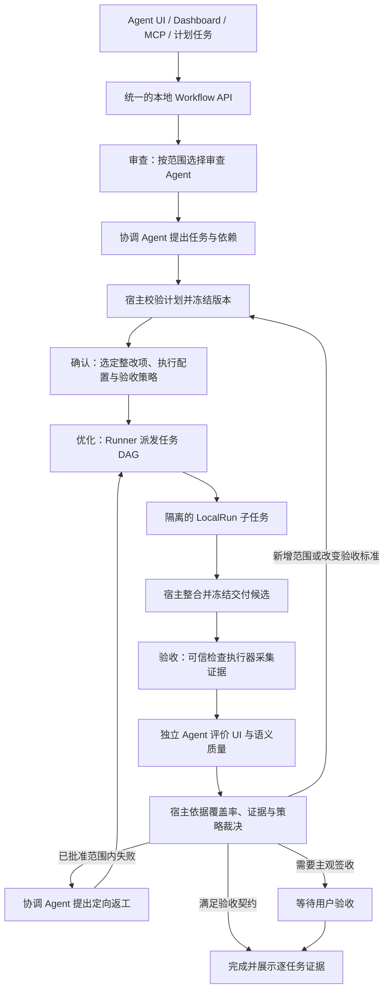

# HiMind Agent 闭环协作架构评估与目标方案

日期：2026-11-09
状态：建议方案，尚未完整实施或通过真实闭环验收
适用范围：HiMind 本地 Agent 工作流内核；UI 专业打磨团队作为首个验证场景。Dashboard、Agent UI、MCP 与计划任务均为入口。

## 1. 结论与验收目标

推荐采用：固定业务状态机 + 协调 Agent 提出结构化任务计划 + 宿主校验并调度任务 DAG + 隔离执行 + 证据驱动的验收。

四个业务阶段保持为“审查 → 确认 → 优化 → 验收”。协调 Agent 在审查阶段汇总问题并提出任务，Runner 在确认后派发子运行，验收失败时在已批准范围内定向返工。任务数量由实际问题决定，角色、客户端和模型由执行绑定决定。

对当前本地桌面产品，这是合理的复杂度：继续复用 WorkflowRunner、LocalRun、SQLite Ledger、Candidate 与 Artifact，不新增独立的调度服务和另一套任务状态系统。工作流内核负责通用机制，ui-craft-team 负责 UI 审查判据、角色和页面验证模板。

一次运行的完成标准：用户确认的每个整改任务，都有对应代码变化或经确认的其他处置、绑定当前交付候选的验证证据、明确的验收结论；必要的人类签收或事先授权的验收策略已满足。

## 2. 证据边界

本评估依据当前工作树，并区分已部署能力与未提交的原型。工作流模块回归结果为 175 passed / 0 failed；这验证了相应代码路径和契约，不能证明真实 AI、文件修改、浏览器验证与业务确认已经连通。

此前真实双 Agent 无工具测试仅证明并发调用、角色与模型记录可用。此前 UI 审查报告明确说明只做了静态阅读，命令和视口验证未执行。当前 ui-craft-team 1.2.0 原型尚无完整真实闭环验收证据。

## 3. 当前架构评估

| 优先级 | 发现与机制 | 证据 | 对闭环的影响 |
|---|---|---|---|
| P0 | UI 包以模型输出的 GATE.passed 作为循环退出条件；schema 只约束输出结构，未在此链路验证全部批准任务的覆盖与证据真实性 | workflows/ui-craft-team/workflow.json:244；src/workflow/runner.rs:1357；schemas/acceptance-verdict.schema.json | 模型可能在缺少实际检查时声明通过。独立角色不等于独立可信的执行证据 |
| P0 | 方案确认未绑定整改计划的版本、内容摘要和选中任务；审批 ID 由 run_id 与 step_id 组成 | src/workflow/mod.rs:269；src/app/workflow_approval.rs:163 | 尚无“确认的方案就是随后执行的方案”的完整契约。已有 LocalRunExecutionPlan.plan_digest 约束执行分段，不能替代整改计划摘要 |
| P1 | 业务工作流审批与工具权限策略复用；full_access 可使工作流审批自动放行 | src/approval/manager.rs:155、210 | 工具完全放行与用户同意整改方案是不同语义，需要独立策略，避免 UI 显示需要确认而实际直接推进 |
| P1 | delegate 子步骤硬编码 local_write，未继承审查父步骤的只读要求 | src/workflow/runner.rs:1654；src/workflow/runtime.rs:395 | 只读审查仍可能申请源码写权限，重现与任务本身无关的 ACL 依赖 |
| P1 | 实施分支固定为四类并顺序运行，分支是否有任务依赖提示词判断 | workflows/ui-craft-team/workflow.json:249、255 | 可作为共享工作区的过渡措施，不能实现按实际整改任务动态派发和依赖调度 |
| P1 | 子运行继承父运行所有已完成步骤输出，并合并输入中的内部上下文字段 | src/workflow/runner.rs:2942 | 上下文随循环膨胀；嵌套命名、过期结果与输入来源缺乏明确边界，影响独立评价 |
| P2 | 包没有声明闭环交付 artifacts；修改、检查和 verdict 主要通过 JSON 自述传递 | workflows/ui-craft-team/workflow.json:371 | 真实证据与当前候选版本之间的关系尚未建立 |

当前基础值得保留：已有子运行、依赖、循环上限、运行台账、取消、租约、模型路由和 Artifact 校验。Candidate 已支持源码身份冻结，Runner 对 acceptance_report 也有证据摘要校验。这些机制需要接入 UI 团队链路；不能据此认为本链路已经具备完整验收保障。

## 4. 总体结构与职责



- 协调 Agent：汇总、去重、解释、提出任务依赖和返工建议。其输出是提案，不直接改变任务状态或授权范围。
- 计划编译器与策略校验器：校验 JSON、依赖无环、任务覆盖、路径、能力、预算、验收要求，生成规范化执行计划。
- Runner：唯一的调度与状态迁移主体，持久化子任务、控制并发、批准边界、超时和恢复。
- 执行 Agent：完成单个分配任务，提交补丁和说明；自报完成只代表可以送验。
- 检查执行器：由宿主启动实际命令或浏览器测试，记录真实执行结果。
- 评价 Agent：对 diff、截图、检查结果作质量判断。其结论是验收输入，不能覆盖失败的必需检查。
- 验收策略：由宿主程序计算是否满足批准的验收契约，必要时等待用户签收。

业务阶段、任务状态与进程状态分别表达。子进程退出成功、模型结束回答、任务通过验收、业务运行完成是四件不同的事。

## 5. 任务与确认契约

建议新增通用的 TaskSpec / ApprovedPlan 契约，并投影到现有 LocalRun，而非建立第二套顶层任务系统。

```text
TaskSpec
  id, finding_ids, objective, deliverables
  depends_on[]
  read_paths[], write_paths[], write_resources[]
  required_capabilities[]
  execution_binding
  acceptance_criteria[], required_check_refs[]
  deadline, token_limit, repair_limit

ApprovedPlan
  run_id, revision, plan_hash, base_snapshot_digest
  selected_task_ids[], tasks[]
  execution_policy, acceptance_policy, budget
  approver_or_delegated_policy, approved_at

ArtifactRef
  id, type, sha256, producer_run_id, task_id
  plan_hash, candidate_digest, created_at, location
```

`plan_hash` 对规范化后的实质内容计算，覆盖任务选择、依赖、允许路径、验收、执行策略和预算。候选模型与允许的替代策略也在其中。用户修改选择后，宿主先生成新计划，再显示最终确认内容；有依赖的任务要检查选择是否闭合。

计划实质变化时，相关确认失效。修复代码而不改变已批准目标、路径和判据可以继续；新增任务、扩展路径、降低判据或超过授权预算需重新确认。把确认记录和内容摘要、审批主体及时间一起存入 Ledger。

工具权限审批和业务确认应分开。允许长期全自动运行时，通过用户明确授予的业务策略限定项目、任务类型、变更范围、预算、有效期和验收方式，记录策略来源；不从 full_access 隐式推断用户已经认可任意整改方案。

不应机械增加确认次数。任务入口已经给定明确审查范围时可直接审查；整改方案需要确认。最终签收是否人工，由本次确认的验收策略和主观判据决定。

## 6. 调度、隔离与工作区

任务按整改项或可独立交付的工作包生成，不按 IA/CRAFT/A11Y 等分类固定创建四个实施 Agent。分类用于选择专业能力，依赖图决定调度。

第一阶段采用同一源码工作区的串行写任务：保留原工程目录，限制单个写入者，记录每个任务的输入与产物，尽快验证真实闭环。审查任务可并行读取同一基线。

需要并发修改后，再引入每个独立任务或冲突组一个 Git worktree；由宿主将补丁整合到集成候选并重新验收。共享 CSS、lockfile、配置及生成文件属于资源冲突，即使角色不同也要建依赖或资源锁。合并冲突只能在批准范围内解决，整合后的验证结果才可交付。

保留用户原路径和项目身份。worktree 是并发编辑的隔离机制，不是修复中文路径或 ACL 失败的绕路方案。运行时 home 隔离只隔离会话配置和缓存，不提供源码编辑隔离；源码快照还必须包含本次明确选定的未提交输入。

能力策略单独声明读取、源码写入、构建输出写入、网络与工具权限；风险等级用于审批，不能替代这些具体权限。验收进程可以写临时目录、截图和构建产物，同时保持待验源码不可变。

## 7. 可选模型与可选外部 AI 客户端

把执行器、协议、模型路由、工具集合与权限作为独立字段，经过兼容性校验后绑定到任务。

| 配置维度 | 意义 | 约束 |
|---|---|---|
| executor | HiMind 内置执行器或某个外部 AI 客户端 | 必须真实安装、能启动，并满足任务工具要求 |
| transport | native / ACP / CLI | ACP 优先用于已通过能力验证的外部客户端；保留 CLI 适配 |
| model_route | 内置模型服务或客户端暴露的模型标识 | 内置服务模型与外部客户端模型分别发现，不承诺任意组合 |
| tool_profile | 源码读取、编辑、浏览器、终端等 | 任务需要什么能力，就验证执行器是否能兑现 |
| filesystem/network policy | 允许访问和修改的资源 | 由实际执行后端保证；协议层同意不构成 OS 隔离 |
| budget/deadline | 单任务及总运行限制 | 不可计量的外部成本明确标为未知，不宣称已实施精确金额限制 |

默认按角色配置，允许按任务覆盖；在确认前展示最终解析值。角色提供能力偏好，用户在本次任务中的明确绑定优先。启动后保存冻结的绑定，恢复执行不能重新隐式解析到不同配置。

模型服务选择与客户端选择是两个用户决策，但可用组合由客户端支持决定。内置执行器通过 HiMind Gateway 选服务模型；外部客户端一般使用自己的登录、订阅或 API 配置，只能选择其暴露的模型。支持自定义 endpoint 的客户端也需要专门验证，不能假定所有客户端都能消费任意 HiMind 模型。

当前已有模型/客户端路由代码；后续重点是能力发现、完整绑定及证据语义。保留 requested_model、negotiated_model、provider_reported_model 及来源。客户端只接受了选择参数不等于上游确实执行该模型；没有证据就记录 unknown。

故障切换只能在已批准的可替代策略内执行，且必须显式记录原因、旧绑定、新绑定和尝试编号。提交 prompt 后结果未知时，先检查子进程、会话与工作区，再决定是否重试，避免两个执行器重复写入。

## 8. ACP 的定位与当前链路

建议 ACP 成为外部客户端的首选通信适配，使用前验证具体客户端、版本和能力；无需把内置推理与宿主检查命令也包装成 ACP。

当前出站链路在 `src/workflow/runtime.rs:154` 进入 `src/runtime/acp.rs`，会驱动 initialize → session/new → 可选 session/set_config_option → session/prompt，并收集会话、更新、工具调用和权限请求信息。模型选择依据客户端返回的 config_options；没有相应配置项或模型不在候选中时会报错。它证明代码中存在 ACP 路径，尚不能证明每个已列客户端的真实执行链路已验收。

```text
Runner -> ExecutionBinding -> ACP adapter -> 外部客户端进程 -> 其模型服务
                                      <--- 会话更新、工具事件、权限请求
宿主 -> 权限/隔离执行后端 -> 文件、进程、浏览器等实际资源
宿主 -> Evidence Store / Ledger -> 当前候选的可验证证据
```

`src/acp.rs` 是 HiMind 对外提供 ACP 服务的方向，不能与 `src/runtime/acp.rs` 中 HiMind 调用外部客户端的方向混为一谈。

能力登记至少涵盖协议版本、模型发现/选择、会话恢复、取消、工具事件、文件/终端请求、MCP 接入及权限强制能力。区分静态声明、握手协商结果和实际探测结果。某个客户端可以自主执行终端而不请求宿主文件接口；应测试具体任务所需的能力，不一律要求所有 ACP 接口。

参考 agent-autoloop 的 checkout `24e21c6ba7c30808467ee93c99b3a1200ac9246e`：DSH 插件按 read/edit/full 映射 native 权限模式；ACP bridge 管会话和权限交互；Windows worker 使用 Job Object 清理进程树。值得借鉴其后端边界和进程生命周期机制。ACP 自身不提供 OS 沙箱，切换协议不会自动修复本地 ACL 问题。

参考源：
- https://github.com/KKKKhazix/agent-autoloop/blob/24e21c6ba7c30808467ee93c99b3a1200ac9246e/plugins/dsh/agent.ts
- https://github.com/KKKKhazix/agent-autoloop/blob/24e21c6ba7c30808467ee93c99b3a1200ac9246e/plugins/acp/bridge.ts
- https://github.com/KKKKhazix/agent-autoloop/blob/24e21c6ba7c30808467ee93c99b3a1200ac9246e/worker/windows.ps1

## 9. 上下文、证据与验收

子任务只接收显式声明的输入 artifacts、分配的 TaskSpec、批准计划引用与必要的前置任务产物。不要复制全部父级输出或完整对话。跨层引用使用稳定 ID 与来源命名空间，宿主生成运行事实，用户输入不得伪装为内部上下文。

把三类信息分开：Agent 声称完成的工作、宿主记录的执行事实、宿主按验收契约计算的结论。外部客户端的文本或 tool_call 更新有助于追踪，但不能直接充当强可信的退出码和测试证据。

宿主检查执行器实际运行批准的检查模板，记录 command/args/cwd、exit_code、stdout/stderr 摘要与原始日志引用、执行器来源、开始结束时间、candidate_digest、plan_hash。UI 验证额外记录 URL、构建标识、视口、主题、截图、DOM/axe 结果和交互断言。截图存在只证明截图已采集，不能单独证明布局或交互正确。

正式验收针对整合后冻结的 candidate 进行。源码、浏览器服务与构建标识要一致；测试前后的源码身份也要一致。构建输出和验收产物写到声明的目录，不能把产物写入误认为源码漂移。

宿主裁决条件：

```text
全部已批准任务已覆盖
AND 每个必需检查真实执行并通过
AND 证据属于当前 plan_hash 和 candidate_digest
AND 没有未批准的变更或验收判据弱化
AND 独立质量评价满足已批准的判据
AND 所需签收/授权策略满足
```

AI evaluator 可以根据截图、DOM 和 diff 判断质量；不能豁免失败检查或替代缺失证据。无法自动判定的审美与交互项进入 awaiting_acceptance。若用户事先授予明确的自动验收策略，可在该策略范围内完成验收，不追加机械的人工作业。

测试代码本身也可能是合法交付物。允许新增测试及已批准的测试修正，同时保留冻结的必需检查和独立验收断言；不能让实施 Agent 通过删除或降低判据使自己过关。

## 10. 返工、恢复与可观测性

失败分为：传输失败、启动/权限失败、执行失败、验收失败、范围变化。对应重试、环境修复、任务返工、重新确认等不同动作，不能统一交给“再问一次模型”。

验收失败只生成已批准任务的返工建议；Runner 校验目标与写入范围后再次派发。只重新执行受影响的任务及依赖项，并对最终集成候选执行所需验收。未受影响任务的证据复用必须有明确的内容与依赖证明，不能直接沿用旧 passed。

每个任务设置 deadline、模型调用预算与有限返工次数，同时设置总运行预算。按任务类型区分“进程存活”“会话有响应”“工具有产出”“等待人类输入”和“目标有进展”。无工具的规划步骤可能长时间没有工具事件，不能仅用工具心跳判定卡死。

租约用于防止重复调度，不证明任务有效推进。恢复时先核对执行进程与会话、批准计划、输入候选和产物；状态无法确定时应标 interrupted/unknown，不能把有副作用的步骤直接重复运行。

调度 claim 与 attempt ID 持久化，状态迁移使用事务和幂等键；进程启动与数据库无法保证严格 exactly-once，目标应为可核查、可恢复且不产生并发重复写入。Windows 进程树由 Job Object 或等效机制管理；取消先发协议消息、限时等待，再终止进程树。

## 11. Agent 侧 UI

业务视图固定显示四阶段，任务细节按需展开：

- 审查：范围、真实截图/检查、问题、严重度、来源与建议；未实测项明确显示未验证。
- 确认：选中任务、依赖、影响文件、验收标准、客户端/模型、预算与自动化策略，展示确认的计划版本。
- 优化：任务负责人、依赖、当前尝试、实际执行客户端、模型来源、运行进度和返工原因。
- 验收：逐任务的“已修改 / 已检查 / 已验收”状态、前后对比、检查结果及失败项；用户可签收或反馈。

完整阶段视图和确认能力属于 Agent 本地产品。Dashboard 复用相同业务 API；断开 Dashboard 不影响本地继续运行、确认或查看证据。产品主流程不要求用户输入 provider/model alias，也不要求理解 ACP。

## 12. 实施次序与退出条件

1. **先建立可信契约。** 增加整改计划版本/摘要、确认选项、业务审批类型、执行绑定、证据与候选关联；纠正 delegate 权限继承，接入宿主验收裁决。保留串行写任务。
2. **再验证一个最小真实闭环。** 选一个 UI 小组件和 1–2 个问题；真实审查产生计划，用户确认所选任务，协调 Agent 的任务由 Runner 交给真实实施 Agent 修改，宿主检查及独立评价完成验收。确认点使用本次明确的真实决定或既有的有界授权策略。
3. **补齐动态调度与故障恢复。** 从 TaskSpec 编译实际子任务，不运行空任务；加入依赖、资源冲突、定向返工、断点恢复和清晰的 UI 证据矩阵。
4. **按需求扩展并行和客户端矩阵。** 验证 worktree 整合；为每个外部客户端与协议版本建立真实的模型选择、工具调用、取消与权限测试。通过测试的能力才对用户展示为可用。

第一轮真实验收应包含正常路径及至少以下负例：漏验任务、模型伪造 passed、证据绑定旧源码、未确认即执行或计划变更后沿用旧确认。后续覆盖进程中断、权限失败、模型不支持、写资源冲突与取消后残留进程。

交付评估关注闭环完成率、逐任务覆盖率、首次验收通过率、平均返工次数、环境失败率、总耗时、模型调用量及可观测成本。扩展更多角色之前，先让少量真实任务按契约完成。