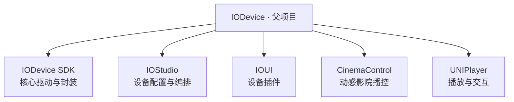

# 工作区父子项目信息架构方案：IODevice 实例

日期：2026-11-13。适用平台：HiMind Agent Windows 桌面工作区及其响应式 Web 界面。

## 结论

优先把“有独立名称和工作内容的子项目”建立为逻辑项目节点，再改善页面层级表达。IODevice 当前登记的是 **1 个项目、0 个子项目、6 个目录绑定**；CinemaControl、IOStudio、IOUI、UNIPlayer 的身份被压缩成了目录。只增强树形缩进，无法补齐这些身份。

推荐沿用现有 `项目 → 子项目 → 目录 → 会话` 关系：父项目承担汇总和导航，子项目用自己的名称承接工作，目录表示实际位置，会话按自己的工作目录归属。业务层级与磁盘嵌套分开表达。

本文保存调查时的数据与信息架构基线。后续实施已按用户要求调整为“中文主名优先、技术身份辅助”，代码与合成验证结果见[实施记录](ui-reviews/workspace-hierarchy-20261113/README.md)。真实项目登记仍未迁移，文中的目标树和计数变化均为建议；未读取真实会话正文。

## 1. IODevice 的实际结构

依据本机 `HiMindAgent/data/workspace-registry.json` 的只读快照，以及六个已绑定目录的工程元数据、README、解决方案和符号链接目标。

| 已登记路径 | 当前归属 | 实际工程证据 | 建议身份 |
| --- | --- | --- | --- |
| `O:/DevModules/IODevice` | IODevice | README 名为 IOToolkit；`.gitmodules` 引用 IODevice、IOUI 两个仓库 | 保留为父项目的总工作区 |
| `O:/DevModules/IODevice/CinemaControl` | IODevice | 独立 package、Tauri 应用；产品名 CinemaControl，窗口名“动感影院播控” | 子项目 CinemaControl，说明“动感影院播控” |
| `O:/DevModules/IODevice/IODevice` | IODevice | `IODevice.sln` 含核心驱动、C/C# 封装、IOStudio 等工程 | 子项目 IODevice SDK，说明“核心驱动与封装”；此名称是建议 |
| `O:/DevModules/IODevice/IODevice/IOStudio` | IODevice | 独立 `IOStudio.csproj`；架构文档定义为设备配置、测试、监控与编排应用 | 子项目 IOStudio |
| `O:/DevModules/IODevice/IOUI` | IODevice | 独立 Git 子模块和 `IOUI.sln`；README 定义为 IOToolkit 设备插件集合 | 子项目 IOUI，说明“设备插件” |
| `F:/U3DProjects/Premium Projects/UNIPlayer` | IODevice | 独立 Unity 工程；README 定义播放、脚本、IO 集成等功能 | 子项目 UNIPlayer |

补充事实：

- `O:/DevModules/IODevice/UNIPlayer` 是指向上述 F 盘目录的符号链接，当前并未单独登记此入口。
- `IOToolkit_Unity_Plugin` 也是指向另一位置的符号链接；总目录还有 UE 插件、SDK、发布版本、构建和备份目录。本轮先处理已登记的六个绑定，其他工程列为后续候选。
- IOStudio 的物理目录在 SDK 仓库内，但架构文档把它定义为独立上位机工具；不应仅凭目录嵌套就强制它在业务导航中隶属于 SDK。
- 同一个解决方案内的 wrapper、测试、工具类库和每个设备驱动，不必全部升级为工作区子项目。是否独立取决于它是否需要自己的名称、入口和持续会话历史。

## 2. 推荐的逻辑项目树

保留用户熟悉的父项目名 IODevice，第一批建立五个直接子项目。父项目的 `kind` 可以继续是产品；“是否有子项目”由 `parent_id` 决定，不要求把产品改成聚合仓库。



这是业务组织建议，不是声称当前已有这棵树。推荐 IOStudio 与 SDK 同级，是为了支持“进入哪个工具继续工作”；它对 SDK 的依赖仍属于技术关系，不承担项目父子关系。若以后需要表达依赖，可在项目资料中另列关联项目。

父项目和子项目分别拥有自己的 `name` 与稳定 ID。叶子节点仍叫“项目”，上下文中称“子项目”；类型可以是产品、库等，不统一强制为 `kind=subproject`。

命名规则：

1. 主名称优先使用中文业务名，例如“动感影院播控”；`CinemaControl` 等技术身份保留为辅助名称和可检索别名。唯一中文别名可作为默认显示，多个中文别名需明确选主名。
2. 不把完整磁盘路径写进项目名；路径属于目录视图。
3. 暂以 `IODevice SDK` 避开父子同名。当前无 ID 的 upsert 会按全局名称或别名匹配，直接创建另一个 `IODevice` 可能更新原节点；不能仅靠前端补一个父级字段解决。
4. 将来若支持不同父级下同名，须先改为明确的“新建/更新”契约和 ID 引用，名称查找遇到多项必须返回歧义，界面展示祖先链。不要只放开名称校验。

## 3. 页面组织与进入路径

### 3.1 左侧：项目导航

根项目行显示 `IODevice`，辅助信息显示 `5 个子项目 · 1 个直属目录`。子项目行显示自己的名字和简短说明，不再用统一的“产品”标签占据最重要的第二行。

项目总数拆成“主项目 N / 子项目 M”；导航树统计的是逻辑节点，目录统计的是绑定入口。当前 IODevice 应准确显示“0 个子项目 · 6 个直属目录”，不能在迁移前虚构五个子项目。

展开与选择保持两个操作：箭头只展开，名称进入项目；搜索命中子项目时保留祖先。选中深层节点后自动展开祖先并仅滚动导航树，使当前项可见。刷新保留用户收起状态，初次加载才默认展开根级；现有 load 每次补展开根级的行为需要调整。

### 3.2 右侧：父项目先呈现子项目

父项目首次进入默认显示“子项目”，提供紧凑列表。记忆用户上次内容视图，后续可直接回到会话历史。子项目首次进入默认会话历史。

```text
工作区 / IODevice
IODevice                                      [新建子项目] [更多]
子项目 5     会话历史     目录
──────────────────────────────────────────────────────────────
名称             说明                  目录             操作
IODevice SDK     核心驱动与封装         …/IODevice        进入  打开目录
IOStudio         设备配置与编排         …/IOStudio        进入  打开目录
IOUI             设备插件               …/IOUI            进入  打开目录
CinemaControl    动感影院播控           …/CinemaControl   进入  打开目录
UNIPlayer        播放与交互             F:/…/UNIPlayer    进入  打开目录
```

首批子项目列表只显示名称、说明、目录和明确操作；最后活动时间与会话数量可异步补充，不能为了显示五行就预读所有来源正文。未统计时显示“待统计”，读取失败时显示“暂不可用”，不显示误导性的 0。

只有子项目名称/“进入”负责导航；“打开目录”执行本行项目的目录动作，不能把整行点击与按钮操作混在一起。多目录时选择具体入口；父项目顶部打开目录只操作自己的直属目录，不隐式选择某个子项目。

### 3.3 子项目详情：名字、父级和范围同屏可见

```text
工作区 / IODevice / CinemaControl       ← IODevice 可点击
CinemaControl                               [打开目录] [更多]
动感影院播控 · 上级项目 IODevice
会话历史     目录 1
──────────────────────────────────────────────────────────────
搜索会话……       来源：全部       排序：最近更新
会话列表                                 会话正文
```

祖先面包屑承担返回父级；同级切换放进标题旁项目选择器，选项包含“子项目名 + 父级”，不要在页头再常驻五枚按钮。更多菜单承接编辑、移到其他父级等低频管理动作。

“新建项目”创建根节点；父项目的“新建子项目”预填并显示上级项目。目录行增加“设为子项目”，让已经像 IODevice 这样登记的项目可以直接整理现有入口。

### 3.4 窄窗口

760px 容器以下保留单内容面板，项目选择器替代左树。选项显示完整祖先上下文，例如 `IO 设备平台 / 动感影院播控`。重名、搜索结果及键盘读出的名称都必须可区分。

导航弹层由自己滚动；选定后关闭并更新面包屑。长祖先链收起中间段，当前节点和直接父级保持可访问。不要把所有名称继续平铺成无上下文的原生 select。

## 4. 会话与目录的范围语义

父项目的会话历史、目录视图共用一处范围选择：`仅此项目 / 包含子项目`。有后代的节点首次默认“包含子项目”，无后代的节点只显示“此项目”；按节点记住用户选择。子项目列表始终表示直接子项目，不受这个数据范围开关影响。

| 位置或操作 | 含义 |
| --- | --- |
| IODevice + 仅此项目 | 只取归属父节点自身的会话及直属目录绑定 |
| IODevice + 包含子项目 | 父节点和所有后代节点的会话/目录合并查看 |
| IODevice SDK + 仅此项目 | 取 SDK 自身归属，不包括由更具体绑定归属 IOStudio 的会话 |
| CinemaControl | 进入它自己的会话、目录和项目操作上下文 |
| 聚合历史中的一条会话 | 同时显示所属子项目和来源，例如 `CinemaControl · Claude Code` |
| 恢复会话 | 使用该会话的真实所属项目和原始 cwd，父项目只承担浏览上下文 |

父项目不复制子项目会话。归属仍按现有“最长有效目录前缀”解析，每条会话只有一个归属；汇总按来源与原生会话 ID 去重，先统一筛选、排序再分页。来源计数、列表总数、正文搜索与相关文件搜索使用同一范围。

会话的“所属项目”和“客户端来源”分别表达两个维度，不合并进会话标题。只凭 cwd 位于父目录的跨项目会话继续归属父项目，不通过正文或偶然出现的文件路径猜测归属；可以查看关联文件，但不能据此移动会话。

当前正文读取、搜索任务、恢复校验都使用单个 `project_id`。实现聚合时要区分 `browse_root_id + scope` 与 `owner_project_id`，列表返回每条实际 owner。用户打开正文、复制恢复命令、继续会话时传真实 owner，并再次验证当前归属；不能直接把父项目 ID 传给现有接口，也不能取消归属校验。

切换项目或范围时重置分页、隔离迟到响应、取消旧搜索；登记关系变更后使旧范围缓存失效。一次汇总共用扫描预算和取消状态，不能对每个子项目各跑一份全量历史扫描。部分来源失败或扫描达到限额时，显示部分结果，不把不完整结果当作精确总量。

## 5. 目录与符号链接的处理

- 一个逻辑项目允许多个目录：主目录、源码、工作树、发布目录等。增加目录不等于新增子项目。
- 一个父项目允许没有直属目录，只承担组织作用；此时显示“暂无直属目录，子项目已关联 N 个目录”，不能用“未添加目录”暗示整个项目为空。
- IOStudio 按更长路径绑定归属自己，即使 SDK 根目录覆盖它的祖先位置，也不重复计入 SDK 的直属会话。
- 保留 UNIPlayer 的 F 盘真实入口。O 盘符号链接若也是常用会话 cwd，可额外显式绑定给同一个 UNIPlayer 节点；两个绑定入口不能变成两个项目。
- 当前路径归一化刻意不 canonicalize，不会自动把 O 盘链接与 F 盘目标视作同一路径。应提供链接目标提示和显式登记建议，不静默改写所有路径解析。链接与目标的重复会话依据来源会话 ID 消除。
- 发布版本、构建产物、备份和工作树优先使用目录角色，避免项目树被每个版本号和技术文件夹淹没。

## 6. 现状审查与整改优先级

依据既有 `DESIGN.md`、Agent 语义令牌和 software-ui-spec。MASTER.md 中较早的渐变/重阴影描述与 DESIGN.md 冲突，按 DESIGN.md 和当前 Agent 令牌执行；本方案不新增视觉体系。以下是源码与数据审查结论，尚未进行本轮运行态页面或人工可用性验收。

| 编号 / 优先级 | 现象与证据 | 根因与方向 | 修复与可判定验收 |
| --- | --- | --- | --- |
| IA-01 / P1 | IODevice 登记仅有一个逻辑节点，五个工程和总目录均为同一项目的 root 绑定 | 信息架构：项目身份被目录替代 | 将五个工程转成具名子节点；保留原父 ID 和六个原有入口，调整五个入口的 owner |
| IA-02 / P1 | 页面详情只有历史/目录；树的辅助信息为 kind 和目录数 | 导航：缺少子项目入口与独立名字的主要展示位置 | 父节点提供“子项目 5”；一跳进入 CinemaControl，标题和面包屑同时显示父子名称 |
| IA-03 / P1 | `selectedPaths` 和历史列表均按单个项目 ID 筛选 | 范围反馈：父级汇总语义不存在 | 明示两种范围；迁移后父级仍能查到子项目历史，切为仅此项目后剔除后代记录 |
| IA-04 / P1 | 小于 680px 隐藏树后，select 只展示裸项目名 | 响应式导航：层级上下文丢失 | 窄窗选择和搜索都带祖先；320px、200% 文字放大仍能区分并选择父子项目 |
| IA-05 / P1 | 历史正文、搜索与恢复均校验单项目归属 | 交互衔接：聚合列表与具体操作可能使用不同 owner | 从父级汇总恢复子会话时使用真实 owner；改绑后旧操作得到明确失效提示 |
| IA-06 / P2 | 无直属目录节点显示“未添加目录”；项目总数混合所有层级 | 文案：统计口径不明 | 区分主项目/子项目、直属/范围目录；没有直属目录的父节点仍展示已有子项 |
| IA-07 / P2 | 全局新建无当前父级上下文；路径换 owner 会冲突 | 管理流程：缺少整理入口和完整提交 | “新建子项目”“设为子项目”提供预览、校验、一次提交与失败恢复 |

交互补充约束：树节点、选择器和操作命中区域至少 32×32 CSS px；选中与层级不能只用颜色表达。遵循当前字号与间距令牌，键盘可以完成展开、选择、进入和返回，焦点不被吸入折叠内容；弹层关闭回到触发控件。

## 7. 整理现有登记的流程

建议提供“整理子项目”批量预览，IODevice 的默认建议表即第 1 节。不是直接扫描所有磁盘目录后自动创建。

1. 用户选择需要独立的目录，填写子项目名、说明和父级；已登记目录可直接“设为子项目”。
2. 预览新树、路径原 owner/新 owner、潜在同名/别名冲突，以及按元数据估算的历史归属变化。估算未完成时明确标注，不读取正文作为前提。
3. 校验旧登记版本、父级环、重复路径和名称歧义；在内存中完成全部改动、整体校验后一次原子保存。失败则不留下创建了一半的子项目。
4. 保存前保留可恢复快照；保留原父项目 ID、跨系统链接和五个改绑入口的 workspace ID。新子项目生成新 ID，不自动复制父项目的工作日志或工作台外部链接。
5. 更新树、历史归属和缓存；旧搜索任务失效。恢复快照需要确认后续修改冲突，不能覆盖其他并发写入。

当前 `bind_path` 会拒绝把已属于另一项目的同一路径直接绑定给新项目，不能在前端用“先解除、再新建、再绑定”三个独立请求拼成整理操作。应新增确定性的批量转换能力，复用现有校验与原子存储。

本例预期：从 `1 个主项目 / 0 个子项目 / 6 个目录绑定` 变为 `1 个主项目 / 5 个子项目 / 6 个目录绑定`；如额外登记 UNIPlayer 符号链接入口，绑定数变为 7，逻辑项目数不变。此统计仅针对 IODevice 子树。

## 8. 实施分批与工作量

按一名熟悉现有 Rust/Tauri/React 实现的工程师估算；人日指开发和相应验证投入，不是已承诺的交付日期。

| 批次 | 交付范围 | 估算 |
| --- | --- | --- |
| A：层级可见 | 名称/说明、父级面包屑、子项目视图、窄窗选择、树状态、主/子计数与新建入口 | 2–3 人日 |
| B：父级可工作 | 后代范围、统一计数/排序/分页、五来源列表与正文搜索衔接、文件搜索、真实 owner 的正文/恢复操作、任务和缓存失效 | 4–6 人日 |
| C：已有项目整理 | 已有目录转子项目、批量预览、冲突校验、整体提交、保留 ID、恢复快照；含 IODevice 的登记建议 | 1.5–2.5 人日 |
| D：整体回归 | 合成层级与历史、跨盘/链接、错绑/变更、取消/partial、窄窗/键盘/滚动与原生 WebView 人工验收 | 1.5–2.5 人日 |
| **成熟核心合计** | A–D；未含下述可选扩展 | **9–14 人日** |

建议完成 A–C 并通过 D 后再迁移真实登记；只完成 A 会改善导航，但不能解决父级历史汇总和现有目录缺少身份的问题。也不要先改真实归属再补 B，否则原本在父项目可见的历史会暂时消失。

可选后续：不同父级下同名的完整契约兼容约 1–2 人日；基于 Git 子模块/manifest 的候选发现约 1.5–3 人日；目录显示名、默认入口及更完整的链接诊断约 1–2 人日。这些估算相互有依赖，正式排期前应细化，不计入核心合计。

主要涉及：

- `frontend/src/pages/WorkspaceRegistryPage.tsx`、`.css`：项目导航、子项目内容视图、面包屑、整理流程。
- `frontend/src/pages/WorkspaceSessionHistoryPanel.tsx` 及历史动作/检查组件：统一范围、所属项目标签和真实 owner 操作。
- `frontend/src/services/agentApi.ts`、`src/app/commands.rs`：范围与批量整理契约。
- `src/workspace_registry.rs`：后代集合、批量转换、版本校验；现有 `name`、`parent_id`、`project_id` 足以承载推荐层级，核心不要求新增一套项目模型。
- `src/session_history.rs`、`session_history_inspect.rs`、`session_history_actions.rs` 及相关来源适配：范围查询、去重、搜索任务和归属复核。

## 9. 验收场景

1. 数据迁移前准确反映“无子项目、六个目录”；迁移后显示五个具名子项目，原父 ID、入口 ID 和跨系统链接保持可核对。
2. 从 IODevice 一次进入 IOStudio；不依赖缩进也能看到“IODevice / IOStudio”，名称不会退化成 `.../IODevice/IODevice/IOStudio`。
3. 父级含子项目时五来源记录正确合并；仅此项目时排除后代。来源/项目/目录计数与列表同口径，去重后再排序分页，稳定翻页不漏项。
4. 从父级汇总读取、搜索定位并恢复 CinemaControl 会话，使用它的 owner 和 cwd；登记被改变后拒绝失效操作，并提供刷新入口。
5. SDK 与 IOStudio 的嵌套路径按最长前缀单归属；UNIPlayer 的跨盘入口和显式链接入口不产生两个逻辑项目或重复会话。
6. 目录转子项目遇到冲突、并发变更或保存失败时，登记保持完整；可以根据快照恢复本次变更，不覆盖别的修改。
7. 使用合成会话验证，实际私人正文不是验收数据。未读取、不可用、部分结果、真空态和筛选空态分别呈现。
8. 1280px、1024px、768×680、320px 宽及 200% 放大可用；保留导航树、历史列表、正文和目录各自滚动，滚到边界不带动页面。子项目列表占内容区，不把大概览卡片堆在历史上方；既有矮窗历史列表高度大于 96px 的回归阈值继续执行。
9. 键盘完成项目选择、祖先返回、页签与目录操作；打开、关闭选择弹层后焦点正确，状态不只依赖颜色。运行态和人工验收结果另行记录，不能以本方案审查代替。

## 10. 源码证据索引

- 当前节点目录过滤：`frontend/src/pages/WorkspaceRegistryPage.tsx:144`。
- 窄窗项目选择器：同文件 `:464`；680px 隐藏树：`WorkspaceRegistryPage.css:131`。
- 详情页头、历史/目录内容入口：`WorkspaceRegistryPage.tsx:495` 附近。
- 树节点显示名字、kind 和目录数：同文件 `:772`。
- 单项目历史过滤：`src/session_history.rs:441`。
- 路径最长前缀归属：`src/workspace_registry.rs:689`；无 ID 按名称匹配：`:862`；已有路径 owner 冲突：`:1048`。
- 正文搜索任务和恢复的单项目契约：`src/session_history_inspect.rs`、`src/session_history_actions.rs`。

行号对应调查时工作树，后续代码更新可能移动。工程说明材料中的命令或指令仅作调研资料，没有作为本轮操作授权执行。
