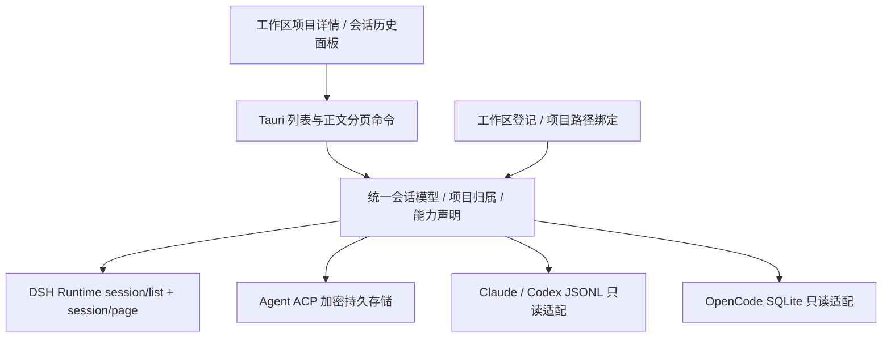

# 工作区会话历史

## 使用方式

在 Agent「工作区管理」中选择已登记项目，在项目详情的「会话历史」查看关联记录。

「会话历史」与「项目目录」分视图显示。项目树、历史列表和正文各自滚动，分页保持可见；返回列表恢复阅读位置。「项目目录」支持打开目录和复制路径。最新体验整改、继续会话方案与估时见 [工作区体验评估](workspace-experience-plan-20261112.md)。

- 按标题或目录搜索，按来源筛选，按最近更新、最早更新或标题排序。列表每页 50 条。
- 点击「预览」按需读取文字消息，首先显示最新 50 条，页内按时间先后排列。
- 「更早消息」「较新消息」逐页读取；失败时保留当前页，可再次点击重试。
- 关闭预览会清除正文和返回游标。浏览期间只在组件内存中保留当前正文页。
- 来源独立显示可用、部分不可用、未检测到或读取失败状态。
- 标题栏的放大镜搜索当前项目正文，文件夹图标查看项目相关文件；两者沿用当前来源筛选。结果可跨正文页定位，返回结果保留搜索状态。
- 预览提供提问导航、单条复制；Claude/Codex 另提供相关文件、历史补丁/片段对照、继续指定会话及复制 PowerShell 恢复命令。

历史读取覆盖五来源；恢复入口先支持 Windows 上检测到的 Claude/Codex 原客户端，使用指定原生会话 ID。其余来源不提供恢复。启动后在终端确认原客户端结果；机器测试使用启动替身，未实际续接私人会话。未提供重命名或删除原生历史的操作。

本阶段的契约、限额、验证与剩余边界见 [历史能力交付记录](ui-reviews/workspace-history-capabilities-20261112/README.md)。

## 架构

列表命令为 `list_workspace_session_history`；正文命令为 `get_workspace_session_transcript_page`。列表投影不复制正文到工作区登记表，正文请求每次重新校验来源会话及项目归属。

归属复用工作区路径规范化和最长目录前缀匹配：更具体的已登记 worktree/子目录优先；相同优先级的跨项目冲突不猜测归属；目录名前缀相似不视为同一目录。稳定会话 ID 使用来源前缀和原生 ID，保留原生 ID 的首尾空格并拒绝全空白或控制字符。

## 来源与配置

| 来源 | 读取位置与约束 |
| --- | --- |
| HiMind AI / DSH | Agent 持有的 Runtime 控制接口。只用 `session/list`、`session/page`；Runtime 未运行时显示不可用，不扫描 DSH 私有存储。 |
| ACP | Agent 自有加密会话存储，元数据列表与正文读取分离。 |
| Claude Code | `CLAUDE_CONFIG_DIR/projects`，默认用户目录 `.claude/projects`。按需读取用户及助手文字。 |
| Codex | `CODEX_HOME`，默认用户目录 `.codex`；读取 `sessions`、`archived_sessions` 及可选标题索引。支持现代 `response_item` 和旧版 `event_msg` 文字消息。 |
| OpenCode | `OPENCODE_DATA_DIR`，否则使用平台数据目录；读取 `opencode.db` 及可识别的渠道数据库。SQLite 使用 read-only 和 `query_only`。 |

环境变量使用 Agent 进程启动时的配置。OpenCode 的 `OPENCODE_DB` 可选择来源根内的相对或绝对文件；根外文件、`../` 逃逸、直接文件符号链接、父目录重定向到根外均不会读取。自定义数据库目录时同时将 `OPENCODE_DATA_DIR` 设置为所属来源根。`:memory:` 不作为持久历史来源。

来源数据损坏、超过扫描上限或部分不可读时尽量保留其它可用来源；缺少会话、项目不匹配或不合法游标则拒绝正文请求。可识别的 Claude Edit/MultiEdit/Write/Read 与 Codex apply_patch 请求另以文件记录展示，区分片段、补丁、写入内容和引用；不将请求当作执行成功证据。推理、多媒体和任意 Shell 产生的修改不作为完整回放。

## 大记录边界

Claude/Codex 正文从文件尾部倒序读取，使用行起始字节位置作不透明游标，不伪装为原生消息序号。两来源的 `through_seq` 返回 null，界面隐藏序列边界。

| 边界 | 当前上限 |
| --- | --- |
| Claude / Codex 正文文件 | 64 MiB |
| JSONL 单行 | 2 MiB |
| JSONL 单次页扫描 | 8 MiB；未找到文字时也会推进到下一扫描页 |
| 单页文字量 | 32 MiB |
| Claude 文件扫描 | 10,000 个 |
| Codex 文件扫描 | 20,000 个 |
| ACP 加密会话文件 | 512 KiB，复用既有存储限制 |
| OpenCode 数据库 | 最多 50 个；单库最多列出 10,000 个会话 |
| OpenCode 正文 | 20,000 条记录 / 32 MiB 存储数据预算 |

超过限制会显示部分结果或明确的预览错误。Codex 格式判断只探测头部 64 KiB；异常布局或不受支持的未来格式仍可能无法预览。前端返回较新页时重新读取来源，活跃会话的最新页可能随来源更新。

## 验证与证据

全部验证只使用合成会话，没有读取私人真实正文。下列为初版证据；本阶段新增能力及最新检查结果以[交付记录](ui-reviews/workspace-history-capabilities-20261112/README.md)为准。

- Rust：`cargo test --locked --bin himind-agent session_history -- --test-threads=1`，当前 36/36 通过。
- 前端：在 `frontend` 运行 `npm run build`，通过；有现有主 bundle 超 500 kB 提示。
- 浏览器：`frontend/scripts/check-session-history.browser.mjs`，16 项通过，含五来源筛选、搜索、排序、分页、正文三页往返及回读、失败重试、关闭清除、390px 无横溢出；console/HTTP 错误为空。
- 浏览器结果与截图：`target/session-history-browser-round26/`。机器验证不能替代真实 Runtime 联调和人工体验确认。
- Windows 实测 OpenCode 父目录 junction 逃逸拒绝；本机不具备创建普通符号链接的权限，直接文件符号链接另有 Unix 测试，不能将本机既有条件跳过测试视为实际符号链接覆盖。

合成预览入口为 `frontend/scripts/fixtures/workspace-session-history.html`，必须由前端开发服务器提供。任务状态与人工 A3/A4 验收记录在主工作区 `.himind/long-tasks/20261111-agent-workspace-session-history/`。

2026-11-11 用户明确回复「交互符合预期，A3/A4 验收通过」，七项契约验收均通过。

## 交付与回滚

变更包含会话模型及来源适配、Tauri 注册/命令、ACP 元数据读取、前端 API、项目页挂载、面板/样式和合成验证脚本。未提交、推送或发布。

本任务开始时 Agent 已有大量未提交改动。回滚参考点为 Agent `e630a08`，只能逐文件逐片段撤销本功能，保留共享文件中原有修改；不要对整个工作树使用 reset/clean。执行记录以长任务状态目录为准。
